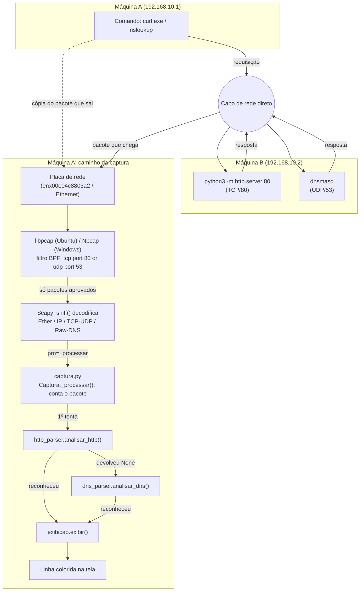
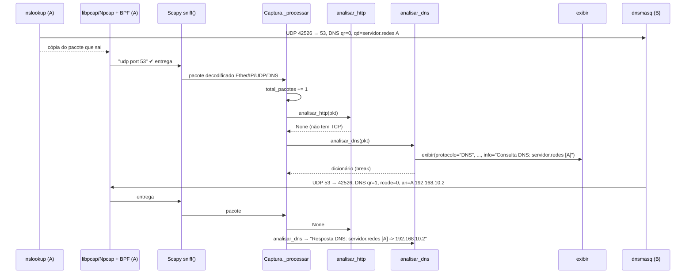
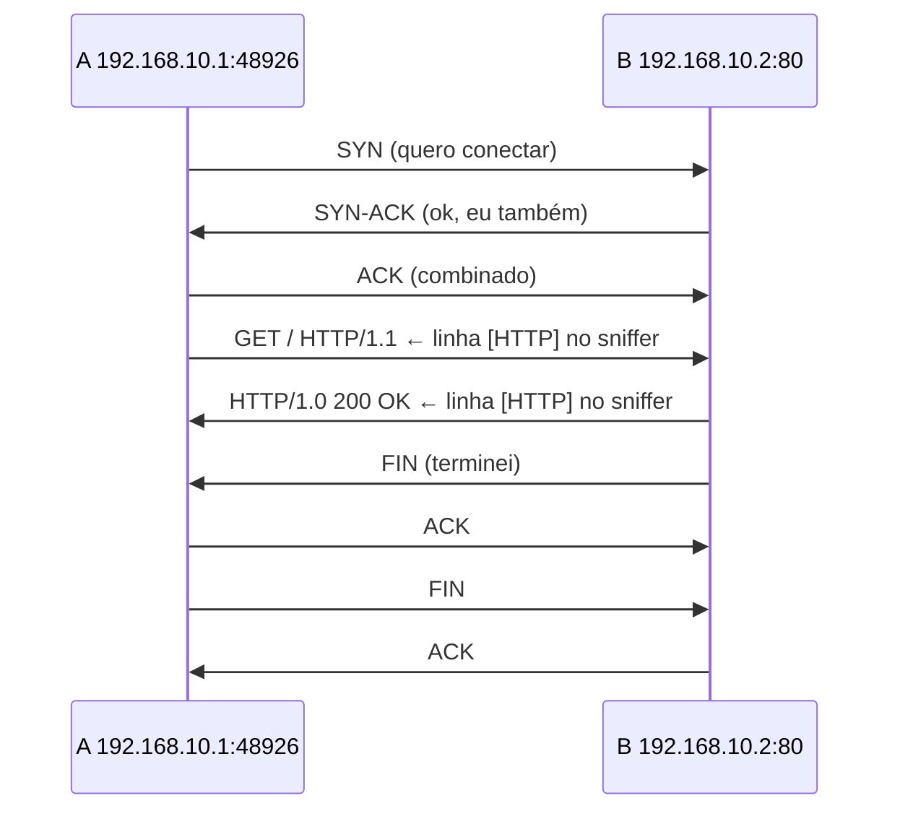

# Como o sniffer funciona por dentro

Explicação de ponta a ponta do projeto `packet-sniffer-redes`: do comando digitado na máquina A até a linha colorida na tela. Todos os trechos de código abaixo foram copiados dos arquivos reais do repositório.

> **Glossário rápido** (termos que aparecem o tempo todo)
>
> | Termo | Significado |
> |---|---|
> | **Pacote / quadro** | Unidade de dados que trafega na rede. "Quadro" (*frame*) é o nome na camada 2 (Ethernet); "pacote" é o nome na camada 3 (IP). No dia a dia usamos os dois como sinônimos. |
> | **Sniffer** | Programa que "escuta" a placa de rede e lê os pacotes que passam por ela. |
> | **Interface** | A placa de rede vista pelo sistema operacional (`enx00e04c8803a2`, `enp1s0`, `"Ethernet"`). |
> | **Payload** | O "conteúdo" de um pacote, o que vem depois dos cabeçalhos. No HTTP é o texto `GET / HTTP/1.1...`. |
> | **Scapy** | Biblioteca Python que captura, decodifica e monta pacotes. |
> | **libpcap / Npcap** | Biblioteca do sistema que realmente lê os pacotes da placa. libpcap no Linux, Npcap no Windows. |
> | **BPF** (*Berkeley Packet Filter*) | Linguagem de filtro executada pelo sistema (dentro do kernel/driver) para descartar o que não interessa antes de chegar ao programa. |
> | **Parser** | Função que "lê" um pacote e extrai dele as informações úteis. |
> | **Callback** | Função passada como parâmetro para ser chamada depois, por outra função. |

---

## 1. Visão geral

O sniffer roda na **máquina A** (cliente, `192.168.10.1`). Ele abre a placa de rede ligada ao cabo, pede ao sistema só os pacotes **TCP porta 80** (HTTP) e **UDP porta 53** (DNS), e para cada pacote:

1. conta o pacote;
2. tenta decodificar como HTTP (método + caminho + Host, ou status da resposta);
3. se não for HTTP, tenta como DNS (domínio consultado, tipo, IPs da resposta ou erro);
4. se reconheceu, imprime uma linha `[PROTOCOLO] IP:porta -> IP:porta | info`.

Ao apertar Ctrl+C, mostra o total de pacotes capturados, que deve ser igual ao do Wireshark com o mesmo filtro.

### Caminho de um pacote



Ponto importante: o sniffer vê **os dois sentidos**. Os pacotes que a máquina A envia (requisições) também passam pela placa e a libpcap/Npcap entrega uma cópia deles ao sniffer. Por isso aparecem tanto `192.168.10.1 -> 192.168.10.2` quanto o caminho inverso.

---

## 2. Mapa dos arquivos

| Arquivo | Para que serve | Item do escopo |
|---|---|---|
| `sniffer/main.py` | Ponto de entrada: lê os argumentos (`--iface`/`--listar`), monta a lista de analisadores, inicia a captura e mostra o total | 1 (orquestra todos) |
| `sniffer/captura.py` | Define o filtro BPF, lista interfaces e faz a captura ao vivo com contagem (`Captura`) | 1, 2, 3 (filtro BPF) |
| `sniffer/http_parser.py` | Reconhece HTTP na porta 80/TCP e extrai método, caminho, Host ou status da resposta | 2, 4, 5 |
| `sniffer/dns_parser.py` | Reconhece DNS na porta 53/UDP e extrai domínio, tipo, IPs ou erro | 3, 4, 5 |
| `sniffer/exibicao.py` | Formata e colore a linha de saída (colunas alinhadas, `rich`) | 4 |
| `tests/test_parsers.py` | 15 testes automáticos com pacotes falsos (sem root, sem rede) | valida 2, 3, 4, 5 |
| `servidor/iniciar_b.sh` | Prepara a máquina B inteira: dependências, IP fixo, firewall, HTTP e DNS | ambiente |
| `servidor/iniciar.sh` | Só o servidor HTTP (Linux) | ambiente |
| `servidor/iniciar_dns.sh` | Só o servidor DNS (Linux, dnsmasq) | ambiente |
| `servidor/iniciar.bat` | Servidor HTTP no Windows (não há DNS no Windows) | ambiente |
| `servidor/index.html` | Página servida pelo `http.server` no `GET /` | ambiente |
| `cliente/iniciar_a.bat` | Atalho de duplo clique que chama o `iniciar_a.ps1` | ambiente |
| `cliente/iniciar_a.ps1` | Prepara a máquina A (Windows): admin, Python, Npcap, IP, testes, sniffer | ambiente |
| `cliente/gerar_trafego.bat` | Gera o tráfego da demonstração passo a passo (6 passos) | gera tráfego para 2, 3, 5 |
| `requirements.txt` | Dependências: `scapy`, `rich` | — |
| `requirements-dev.txt` | `requirements.txt` + `pytest` | — |
| `.gitignore` | Não versiona `*.pcap`, `__pycache__/`, `venv/`, `.pytest_cache/` | — |
| `.gitattributes` | Força fim de linha LF nos `.sh` e CRLF nos `.bat` | — |
| `README.md` | Instalação e execução | — |
| `docs/itens-escopo.md` | Os 5 itens e como validar cada um | — |
| `docs/roteiro-demo.md` | Roteiro da demonstração e tabela de problemas comuns | — |

> **Por que o `.gitattributes` importa:** um script `.sh` com fim de linha do Windows (CRLF) falha no Linux com erros como `/bin/bash^M: bad interpreter`. E um `.bat` com só LF pode se comportar mal no `cmd.exe`. A regra garante que, não importa onde o repositório for clonado, cada script tenha o fim de linha certo para o sistema que vai rodá-lo.

---

## 3. Arquivo por arquivo, na ordem em que o código executa

### 3.1 `sniffer/main.py`: o ponto de entrada

**Papel:** é o arquivo que você executa. Ele não captura nem decodifica nada sozinho: só junta as peças.

#### Importações e o "plano B" da exibição

```python
from captura import FILTRO_BPF, Captura, listar_interfaces
from dns_parser import analisar_dns
from http_parser import analisar_http

try:
    # Função padronizada da Pessoa 4 (item 4).
    from exibicao import exibir
except ImportError:
    # Enquanto o exibicao.py não existir, usa uma saída simples no mesmo formato.
    def exibir(protocolo, ip_origem, porta_origem, ip_destino, porta_destino, info):
        print(f"[{protocolo}] {ip_origem}:{porta_origem} -> {ip_destino}:{porta_destino} | {info}")
```

- Os imports são "soltos" (`from captura import ...` e não `from sniffer.captura import ...`) porque o Python coloca automaticamente a pasta do script executado (`sniffer/`) no caminho de busca. Por isso o comando é `python3 sniffer/main.py`, e os módulos irmãos são encontrados.
- O `try/except ImportError` foi útil durante o desenvolvimento em grupo: enquanto o `exibicao.py` (feito por outro integrante) não existia, o `main.py` funcionava com um `print` simples no mesmo formato. Hoje o `exibicao.py` existe, então o `except` nunca é usado na prática. O comentário "Pessoa 4" é resquício dessa divisão de tarefas.

#### `ler_argumentos()`

```python
def ler_argumentos():
    parser = argparse.ArgumentParser(
        description="Sniffer de tráfego HTTP (TCP/80) e DNS (UDP/53).",
    )
    grupo = parser.add_mutually_exclusive_group(required=True)
    grupo.add_argument("--iface", help="interface de captura (veja os nomes com --listar)")
    grupo.add_argument("--listar", action="store_true", help="mostra as interfaces disponíveis")
    return parser.parse_args()
```

- **Recebe:** nada (lê `sys.argv`, a linha de comando).
- **Faz:** usa o `argparse` para definir duas opções num **grupo mutuamente exclusivo e obrigatório**: o usuário tem que passar **exatamente uma** delas. `--iface X` e `--listar` juntos dão erro; nenhum dos dois também dá erro (`one of the arguments --iface --listar is required`).
- `action="store_true"`: `--listar` não recebe valor; se aparecer, vira `True`.
- **Devolve:** um objeto `args` com `args.iface` (texto ou `None`) e `args.listar` (`True`/`False`).
- De graça, o `argparse` cria o `--help`.

#### `main()`

```python
def main():
    args = ler_argumentos()

    if args.listar:
        print(f"{'NOME':<20} {'IP':<16} DESCRIÇÃO")
        for iface in listar_interfaces():
            print(f"{iface['nome']:<20} {iface['ip']:<16} {iface['descricao']}")
        return
```

- Modo `--listar`: imprime uma tabela simples. `:<20` alinha à esquerda numa coluna de 20 caracteres. Depois retorna sem capturar nada.

```python
    analisadores = [
        lambda pkt: analisar_http(pkt, exibir),
        lambda pkt: analisar_dns(pkt, exibir),
    ]
    captura = Captura(args.iface, analisadores)
```

- Monta a **lista de analisadores**: cada item é uma função que recebe só o pacote. A `lambda` "amarra" o segundo parâmetro (`exibir`) para que a `Captura` não precise saber nada sobre exibição. A ordem importa: **HTTP é tentado primeiro, DNS depois** (ver `_processar`).
- Cria o objeto `Captura` com a interface escolhida.

```python
    print(f"Capturando na interface {args.iface} (filtro: {FILTRO_BPF}). Ctrl+C para parar.\n")
    captura.iniciar()

    print("\n--- Captura encerrada ---")
    print(f"Total de pacotes capturados: {captura.total_pacotes}")
```

- `captura.iniciar()` **bloqueia** (fica parado ali) até o Ctrl+C. Quando o usuário aperta Ctrl+C, o `sniff()` do Scapy trata a interrupção e retorna normalmente; então as duas últimas linhas executam e mostram o total.

```python
if __name__ == "__main__":
    main()
```

- Só chama `main()` se o arquivo for executado diretamente (e não importado).

**Por que assim:** separar `main.py` (orquestra), `captura.py` (captura), parsers (decodificam) e `exibicao.py` (mostra) permitiu dividir o trabalho entre integrantes e testar os parsers sem captura real.

---

### 3.2 `sniffer/captura.py`: a captura ao vivo (item 1)

**Papel:** fala com o Scapy para abrir a interface, aplicar o filtro BPF e entregar cada pacote aos analisadores.

#### O filtro BPF

```python
FILTRO_BPF = "tcp port 80 or udp port 53"
```

- Linguagem BPF (a mesma do `tcpdump` e do filtro de **captura** do Wireshark). Lê-se: "pacotes TCP com porta de origem **ou** destino 80, ou pacotes UDP com porta de origem ou destino 53". `port` sem `src`/`dst` vale para os dois lados, por isso a resposta (que **sai** da porta 80/53) também passa.
- É uma constante para ser **idêntica** ao filtro usado no Wireshark e permitir comparar os totais.

#### `listar_interfaces()`

```python
def listar_interfaces():
    interfaces = []
    for iface in conf.ifaces.values():
        interfaces.append({
            "nome": iface.name,
            "descricao": iface.description,
            "ip": iface.ip or "-",
        })
    return sorted(interfaces, key=lambda i: i["nome"])
```

- **Recebe:** nada.
- **Faz:** percorre `conf.ifaces`, a tabela de interfaces que o Scapy monta ao iniciar (no Linux, a partir do sistema; no Windows, a partir do Npcap). Para cada uma pega nome, descrição e IP (`or "-"` troca `None`/vazio por um traço).
- **Devolve:** lista de dicionários ordenada pelo nome.
- **Por que existe:** no Windows o nome da interface não é óbvio (`"Ethernet"`, `"Ethernet 2"`, `"Wi-Fi"`), e no Ubuntu varia (`enp1s0`, `enp2s0`, `enx00e04c8803a2`). O `--listar` mostra o nome exato a passar no `--iface`.

#### A classe `Captura`

```python
class Captura:
    def __init__(self, iface, analisadores, filtro=FILTRO_BPF):
        self.iface = iface
        self.analisadores = analisadores
        self.filtro = filtro
        self.total_pacotes = 0
```

- Guarda a interface, a lista de analisadores, o filtro (com `FILTRO_BPF` como padrão) e um contador começando em zero.

```python
    def _processar(self, pkt):
        self.total_pacotes += 1
        for analisar in self.analisadores:
            if analisar(pkt):
                break
```

- **Recebe:** um pacote já decodificado pelo Scapy.
- **Faz:**
  1. **Conta todo pacote que chegou**, reconhecido ou não. Isso inclui SYN, ACK, FIN e outros pacotes TCP sem conteúdo. Por isso o total é maior que o número de linhas na tela, e é por isso que ele bate com o Wireshark (que também conta tudo o que passou no filtro de captura).
  2. Chama os analisadores em ordem. Se um devolver algo "verdadeiro" (um dicionário), o `break` para: o pacote já foi reconhecido, não precisa tentar o próximo. Se devolver `None` (falso), tenta o próximo.
- **Devolve:** nada (`None`). O Scapy imprimiria o valor de retorno do `prn` se ele não fosse `None`; como é `None`, nada extra aparece.
- O `_` no início do nome é convenção Python para "método interno, não chame de fora".

```python
    def iniciar(self):
        sniff(iface=self.iface, filter=self.filtro, prn=self._processar, store=False)
```

Cada parâmetro do `sniff()`:

| Parâmetro | Valor | Significado |
|---|---|---|
| `iface` | `self.iface` | Captura **só** nessa placa (a do cabo). Sem isso, o Scapy usaria a interface padrão (que pode ser o Wi-Fi). |
| `filter` | `"tcp port 80 or udp port 53"` | Filtro BPF compilado e instalado **no sistema** (kernel no Linux, driver Npcap no Windows). |
| `prn` | `self._processar` | Função chamada **a cada pacote, assim que ele chega** (é isso que torna a captura "em tempo real"). |
| `store` | `False` | Não guarda os pacotes numa lista na memória. |

**Por que `store=False`?** Com `store=True` (padrão do Scapy), o `sniff()` acumula todos os pacotes numa lista para devolver no final. Numa captura longa isso só cresce, consome memória e deixa o programa mais lento. Como o sniffer só precisa mostrar e contar, não há motivo para guardar. Menos trabalho por pacote = menos risco de o programa ficar para trás e o buffer do sistema encher (que é quando há descarte).

**Por que o filtro BPF fica no sistema e não no Python?** Se o filtro fosse um `if` em Python, **todos** os pacotes da placa (ARP, ICMP, mDNS, IPv6, etc.) teriam que ser copiados do kernel para o programa e decodificados pelo Scapy, que é lento, só para depois serem jogados fora. Com BPF, o próprio sistema descarta o que não interessa antes da cópia. Chega ao Python só o necessário. É o mesmo mecanismo do Wireshark e do tcpdump.

**Como o Ctrl+C funciona:** o `sniff()` do Scapy captura o `KeyboardInterrupt` internamente e retorna normalmente. Por isso o `main.py` não precisa de `try/except` em volta de `captura.iniciar()` e consegue imprimir o total.

> **Observação honesta sobre "sem descarte de quadros":** o código **reduz o risco** de descarte (filtro no kernel, `store=False`, processamento leve), mas **não mede** descartes. O Scapy não expõe as estatísticas de descarte da libpcap (`pcap_stats`). A prova usada no trabalho é **comparar o total do sniffer com o total do Wireshark** na mesma interface e com o mesmo filtro de captura: se os números batem, nenhum pacote foi perdido pelo sniffer.

> Detalhe: a docstring do arquivo diz "para comparar com o   no final" — falta uma palavra (provavelmente "Wireshark"). É só texto, não afeta o código.

---

### 3.3 `sniffer/http_parser.py`: decodificando HTTP (itens 2, 4 e 5)

**Papel:** dado um pacote, decide se é uma requisição ou resposta HTTP e extrai o que interessa.

```python
METODOS_HTTP = ("GET", "POST", "PUT", "DELETE", "HEAD", "OPTIONS", "PATCH")
```

Os métodos reconhecidos. Uma tupla (imutável). `CONNECT` e `TRACE` não estão na lista.

#### `analisar_http(pkt, callback_exibir=None)`

- **Recebe:** o pacote e, opcionalmente, uma função de exibição.
- **Devolve:** um dicionário com 6 campos se reconheceu, ou `None` se não.

**Bloco 1: o pacote tem as camadas necessárias?**

```python
    if not (pkt.haslayer(IP) and pkt.haslayer(TCP) and pkt.haslayer(Raw)):
        return None
```

- `haslayer(X)` pergunta ao Scapy se o pacote contém a camada X.
- `Raw` é a camada que o Scapy usa para "bytes que eu não sei decodificar", ou seja, o payload. O Scapy 2.5 não decodifica HTTP por padrão (a camada `http` dele não é carregada pelo `scapy.all`), então o texto do HTTP fica em `Raw`.
- Um SYN, um ACK puro ou um FIN **não têm payload**, logo não têm `Raw` e são descartados aqui. Por isso um `curl` gera ~10 pacotes, mas só 2 linhas.
- Exigir `IP` significa que **só IPv4** é tratado (IPv6 seria a camada `IPv6`).

**Bloco 2: é porta 80?**

```python
    porta_origem = pkt[TCP].sport
    porta_destino = pkt[TCP].dport

    if porta_origem != 80 and porta_destino != 80:
        return None
```

- `pkt[TCP]` acessa a camada TCP; `sport`/`dport` são as portas (camada 4).
- Requisição: destino 80. Resposta: origem 80. Se nenhuma das duas for 80, não é HTTP (para este sniffer). O BPF já garante isso na captura real, mas a checagem deixa o parser correto sozinho (por exemplo, nos testes ou se alguém mudar o filtro).

**Bloco 3: IPs (camada 3) e payload como texto**

```python
    ip_origem = pkt[IP].src
    ip_destino = pkt[IP].dst

    payload = pkt[Raw].load.decode("utf-8", errors="ignore")
    linhas = payload.split("\r\n")
    if not linhas or not linhas[0]:
        return None
```

- `pkt[Raw].load` são os bytes do payload. `.decode("utf-8", errors="ignore")` transforma em texto; bytes inválidos (por exemplo, uma imagem binária no corpo) são ignorados em vez de gerar erro.
- O HTTP separa linhas com `\r\n` (CR LF). A primeira linha é a mais importante: `GET / HTTP/1.1` ou `HTTP/1.0 200 OK`.
- Se a primeira linha estiver vazia, não há o que mostrar.

**Bloco 4: é requisição?**

```python
    primeira_linha = linhas[0].strip()
    info = None

    partes = primeira_linha.split(" ")
    if partes[0] in METODOS_HTTP:
        metodo = partes[0]
        caminho = partes[1] if len(partes) > 1 else "/"
        info = f"{metodo} {caminho}"

        for linha in linhas[1:]:
            if linha.lower().startswith("host:"):
                info += f" (Host: {linha[5:].strip()})"
                break
```

- A **linha de requisição** do HTTP tem 3 partes separadas por espaço: `MÉTODO CAMINHO VERSÃO`. Se a primeira palavra está na lista de métodos, é uma requisição.
- `caminho` é a segunda palavra (ou `/` se não existir).
- Depois procura o **cabeçalho `Host`** nas linhas seguintes. `.lower()` porque nomes de cabeçalho HTTP não diferenciam maiúsculas. `linha[5:]` pula os 5 caracteres de `host:`. O `Host` diz qual site o cliente quer (no nosso caso, `192.168.10.2`, porque o `curl` foi chamado com o IP).
- Resultado: `GET / (Host: 192.168.10.2)`.

**Bloco 5: é resposta?**

```python
    elif primeira_linha.startswith("HTTP/"):
        info = f"Resposta: {primeira_linha}"
```

- A **linha de status** da resposta começa com a versão: `HTTP/1.0 200 OK`. O `http.server` do Python responde em `HTTP/1.0` (é o padrão dele), por isso a saída mostra `HTTP/1.0` mesmo o `curl` pedindo `HTTP/1.1`.

**Bloco 6: não reconheceu → `None`; reconheceu → dicionário**

```python
    if not info:
        return None

    resultado = {
        "protocolo": "HTTP",
        "ip_origem": ip_origem,
        "porta_origem": porta_origem,
        "ip_destino": ip_destino,
        "porta_destino": porta_destino,
        "info": info,
    }

    if callback_exibir:
        callback_exibir(**resultado)

    return resultado
```

- Se o pacote tem payload na porta 80 mas não começa com método nem com `HTTP/` (por exemplo, a continuação do corpo de uma página grande, num segundo segmento TCP), devolve `None`.
- `callback_exibir(**resultado)` desempacota o dicionário como **argumentos nomeados**: equivale a `exibir(protocolo="HTTP", ip_origem=..., ...)`. Por isso as chaves do dicionário têm exatamente os nomes dos parâmetros de `exibir()`.

**Por que os parsers devolvem `None`?** Por três motivos:
1. **Encadeamento:** em `_processar`, `None` é "falso", então a `Captura` sabe que deve tentar o próximo analisador; um dicionário é "verdadeiro" e para a busca.
2. **Testes:** o teste compara o dicionário devolvido, sem precisar ler a tela.
3. **Separação:** o parser não depende de como a informação é mostrada; o callback é opcional.

#### O bloco `if __name__ == "__main__":`

```python
if __name__ == "__main__":
    def exibir_teste(protocolo, ip_origem, porta_origem, ip_destino, porta_destino, info):
        print(f"[{protocolo}] {ip_origem}:{porta_origem} -> {ip_destino}:{porta_destino} | {info}")

    print("Escutando tráfego HTTP (porta 80)... Ctrl+C para sair.")
    sniff(filter="tcp port 80", prn=lambda p: analisar_http(p, exibir_teste), store=False)
```

Permite testar o parser sozinho (`sudo python3 sniffer/http_parser.py`). Note que aqui **não há `iface`**: captura na interface padrão do Scapy. Não é usado pelo `main.py`.

---

### 3.4 `sniffer/dns_parser.py`: decodificando DNS (itens 3, 4 e 5)

**Papel:** dado um pacote, decide se é uma consulta ou resposta DNS e extrai domínio, tipo e resultado.

#### Tabelas de tradução

```python
TIPOS_CONSULTA = {1: "A", 2: "NS", 5: "CNAME", 12: "PTR", 15: "MX", 16: "TXT", 28: "AAAA", 33: "SRV", 65: "HTTPS"}
ERROS_DNS = {1: "FormErr", 2: "ServFail", 3: "NXDOMAIN", 4: "NotImp", 5: "Refused"}
```

- No pacote DNS o tipo da consulta (`qtype`) e o código de resposta (`rcode`) são **números**. Estes dicionários traduzem para os nomes que as pessoas conhecem. Ex.: `qtype=1` → `A`, `rcode=3` → `NXDOMAIN`.

#### `primeiro_item(campo)`: compatibilidade entre versões do Scapy

```python
def primeiro_item(campo):
    if campo is None:
        return None
    if isinstance(campo, list):
        return campo[0] if campo else None
    return campo
```

- **Recebe:** o campo `DNS.qd` (perguntas) ou `DNS.an` (respostas).
- **Devolve:** o primeiro registro, ou `None`.
- **Por que existe:** o Scapy mudou a forma de guardar esses campos:
  - **Scapy 2.5** (o que está instalado neste Ubuntu, via `apt`): o campo é um **pacote encadeado**; o próprio campo já é o primeiro registro, e os seguintes vêm "grudados" depois dele (como camadas).
  - **Scapy 2.6 ou mais novo** (o que o `pip` instala no Windows): o campo é uma **lista** Python.
- Como a máquina Ubuntu e a máquina Windows podem ter versões diferentes, a função funciona com as duas. Sem ela, `camada_dns.qd[0]` ou `camada_dns.qd.qname` quebraria em uma das versões.

#### `item_numero(campo, i)`

```python
def item_numero(campo, i):
    try:
        return campo[i]
    except (IndexError, TypeError):
        return None
```

- **Devolve** o registro de número `i` da seção de respostas.
- Funciona nas duas versões porque `campo[i]` tem significado nas duas: na lista, é o item `i`; no pacote encadeado do Scapy 2.5, `pacote[i]` devolve a i-ésima camada da corrente.
- Se não existir (`IndexError`) ou o campo for `None` (`TypeError`), devolve `None` em vez de quebrar.

#### `analisar_dns(pkt, callback_exibir=None)`

**Bloco 1: camadas e porta**

```python
    if not (pkt.haslayer(IP) and pkt.haslayer(UDP) and pkt.haslayer(DNS)):
        return None

    porta_origem = pkt[UDP].sport
    porta_destino = pkt[UDP].dport

    if porta_origem != 53 and porta_destino != 53:
        return None
```

- Diferente do HTTP, aqui o Scapy **decodifica o DNS** sozinho: ao ver UDP na porta 53, ele interpreta o payload como a camada `DNS`. Por isso se usa `haslayer(DNS)` e não `Raw`.
- Mesma lógica de porta do HTTP: consulta vai **para** a 53, resposta **sai** da 53.

**Bloco 2: domínio e tipo (seção de pergunta)**

```python
    ip_origem = pkt[IP].src
    ip_destino = pkt[IP].dst
    camada_dns = pkt[DNS]

    dominio = "desconhecido"
    tipo = ""
    pergunta = primeiro_item(camada_dns.qd)
    if pergunta is not None and pergunta.qname:
        dominio = pergunta.qname.decode("utf-8", errors="ignore").rstrip(".")
        if pergunta.qtype in TIPOS_CONSULTA:
            tipo = f" [{TIPOS_CONSULTA[pergunta.qtype]}]"
```

- Um pacote DNS tem seções: **qd** (*question*, a pergunta), **an** (*answer*, respostas), e outras (autoridade e adicionais, que o sniffer não usa).
- A pergunta (`DNSQR`) tem `qname` (o domínio, em bytes, terminando com ponto: `b"servidor.redes."`) e `qtype` (o tipo).
- `.rstrip(".")` remove o ponto final para mostrar `servidor.redes`.
- A **resposta DNS repete a pergunta** na seção qd. Por isso a linha de resposta também mostra o domínio.
- Se o tipo não estiver na tabela, `tipo` fica vazio (não aparece `[...]`).

**Bloco 3: consulta ou resposta? (`qr`)**

```python
    if camada_dns.qr == 0:
        info = f"Consulta DNS: {dominio}{tipo}"
```

- **Por que o `qr` diferencia consulta de resposta:** consulta e resposta DNS usam **o mesmo formato** de mensagem. O cabeçalho DNS tem um bit chamado **QR** (*Query/Response*): `0` = consulta, `1` = resposta. É a forma oficial (RFC 1035) de distinguir. Olhar a porta também daria uma pista (destino 53 = consulta), mas o `qr` é o campo feito para isso.

**Bloco 4: resposta com erro (`rcode`)**

```python
    elif camada_dns.rcode != 0:
        motivo = ERROS_DNS.get(camada_dns.rcode, f"erro {camada_dns.rcode}")
        info = f"Resposta DNS: {dominio}{tipo} ({motivo})"
```

- `rcode` (*response code*): `0` = sem erro. Qualquer outro valor é um erro: `3` = NXDOMAIN (o nome não existe), `5` = Refused (o servidor se recusou), etc.
- `.get(..., f"erro {rcode}")`: se o código não estiver na tabela, mostra `erro N` em vez de quebrar.
- Exemplo real: `Resposta DNS: naoexiste.redes [A] (NXDOMAIN)`.

**Bloco 5: resposta com sucesso → IPs**

```python
    else:
        ips_resolvidos = []
        for i in range(camada_dns.ancount):
            resposta = item_numero(camada_dns.an, i)
            if isinstance(resposta, DNSRR) and resposta.type == 1:  # Registro A (IPv4)
                ips_resolvidos.append(str(resposta.rdata))

        if ips_resolvidos:
            info = f"Resposta DNS: {dominio}{tipo} -> {', '.join(ips_resolvidos)}"
        else:
            info = f"Resposta DNS: {dominio}{tipo}"
```

- `ancount` é o campo do cabeçalho DNS que diz **quantas respostas** existem.
- Para cada uma, pega o registro (`DNSRR` = *Resource Record*). Só registros de **tipo 1 (A, IPv4)** têm o IP coletado (`rdata`).
- `isinstance(resposta, DNSRR)` protege contra registros de outra classe do Scapy (por exemplo, registros DNSSEC) que não teriam os mesmos campos.
- Vários IPs são juntados com vírgula: `-> 10.0.0.1, 10.0.0.2`.
- Se a resposta não tem nenhum registro A (por exemplo, consulta AAAA respondida vazia, ou uma resposta PTR), mostra só `Resposta DNS: dominio [tipo]` sem `->`.

**Bloco 6: dicionário, callback e retorno** — idêntico ao HTTP, com `"protocolo": "DNS"`.

O bloco `if __name__ == "__main__":` também é igual ao do HTTP, com o filtro `udp port 53`.

---

### 3.5 `sniffer/exibicao.py`: mostrando na tela (item 4)

**Papel:** formatar a linha `[PROTOCOLO] ORIGEM -> DESTINO | info` com colunas alinhadas e cores.

#### Import opcional da `rich`

```python
try:
    from rich.console import Console
    from rich.markup import escape

    console = Console(highlight=False)
except ImportError:
    console = None
```

- `rich` é uma biblioteca para texto colorido no terminal (funciona no Linux e no Windows).
- Se não estiver instalada, `console = None` e o programa usa `print` simples. O sniffer não depende dela para funcionar.
- `highlight=False`: por padrão a `rich` colore sozinha números, IPs e textos entre aspas. Isso foi desligado para que só as cores escolhidas apareçam.

#### Constantes

```python
CORES = {
    "HTTP": "bold green",
    "DNS": "bold cyan",
}
LARGURA_PROTOCOLO = 6
LARGURA_ENDERECO = 21
```

- HTTP em verde, DNS em ciano.
- `21` é o tamanho do maior endereço possível, `255.255.255.255:65535`, então as colunas nunca ficam desalinhadas. `6` é o tamanho de `[HTTP]`.

#### `exibir(protocolo, ip_origem, porta_origem, ip_destino, porta_destino, info)`

```python
    origem = f"{ip_origem}:{porta_origem}"
    destino = f"{ip_destino}:{porta_destino}"

    coluna_protocolo = f"[{protocolo}]".ljust(LARGURA_PROTOCOLO)
    coluna_origem = origem.ljust(LARGURA_ENDERECO)
    coluna_destino = destino.ljust(LARGURA_ENDERECO)
```

- Junta IP (camada 3) e porta (camada 4) no formato `IP:porta`.
- `.ljust(n)` completa com espaços à direita até `n` caracteres. Por isso `[DNS]` (5 caracteres) vira `[DNS] ` e, somado ao espaço seguinte, aparecem **dois espaços** depois de `[DNS]` na saída real, alinhando com `[HTTP]`. (O comentário no código fala em `:<`, mas o que é usado de fato é o `ljust`, que faz o mesmo.)

```python
    if console is None:
        print(f"{coluna_protocolo} {coluna_origem} -> {coluna_destino} | {info}")
        return
```

- Sem a `rich`: texto puro, mesmo formato.

```python
    cor = CORES.get(protocolo, "bold white")
    console.print(
        f"[{cor}]{escape(coluna_protocolo)}[/] "
        f"[yellow]{coluna_origem}[/] -> [magenta]{coluna_destino}[/] | {escape(str(info))}",
        soft_wrap=True,
    )
```

- A `rich` usa uma **marcação** com colchetes: `[bold green]texto[/]` pinta "texto" de verde negrito; `[/]` fecha a cor. Origem em amarelo, destino em magenta.
- **Por que o `escape()`:** o texto que queremos mostrar também tem colchetes! `[HTTP]`, `[DNS]` e `[A]` em `servidor.redes [A]`. Sem o `escape()`, a `rich` acharia que `[A]` ou `[DNS]` são comandos de estilo e os **sumiria** da tela (ou daria erro). O `escape()` "protege" os colchetes para serem mostrados literalmente. As colunas de endereço não passam por `escape()` porque IP e porta nunca têm colchetes. O `info` pode ter qualquer coisa (vem do pacote), então é sempre escapado.
- `str(info)` garante que é texto.
- `soft_wrap=True`: a `rich` não quebra a linha no meio por conta própria; se a linha for maior que a janela, o próprio terminal quebra.

---

## 4. Um pacote do começo ao fim

### 4.1 Uma consulta DNS: `nslookup servidor.redes. 192.168.10.2`

Na máquina A, o `nslookup` monta uma mensagem DNS e a envia por UDP para `192.168.10.2:53`, a partir de uma porta efêmera (aleatória), por exemplo `42526`.



Passo a passo da **consulta**:

| Etapa | O que acontece | Valor |
|---|---|---|
| BPF | `udp port 53` aceita (destino 53) | — |
| Scapy | Decodifica Ether → IP → UDP → DNS (porta 53 ⇒ DNS) | — |
| `_processar` | `total_pacotes` passa de N para N+1 | — |
| `analisar_http` | `haslayer(TCP)` é falso → `None` | tenta o próximo |
| `analisar_dns` | tem IP, UDP, DNS; `dport == 53` | ok |
| | `pkt[IP].src`, `.dst` | `192.168.10.1`, `192.168.10.2` |
| | `qd.qname` = `b"servidor.redes."` → `rstrip(".")` | `servidor.redes` |
| | `qtype` = 1 → `TIPOS_CONSULTA[1]` | ` [A]` |
| | `qr == 0` | `Consulta DNS: servidor.redes [A]` |
| `exibir` | `[DNS]`.ljust(6), endereços ljust(21) | ver abaixo |

```
[DNS]  192.168.10.1:42526  -> 192.168.10.2:53     | Consulta DNS: servidor.redes [A]
```

Para a **resposta**: `qr == 1`, `rcode == 0`, `ancount == 1`, o registro é `DNSRR` de `type == 1` com `rdata = "192.168.10.2"`:

```
[DNS]  192.168.10.2:53     -> 192.168.10.1:42526  | Resposta DNS: servidor.redes [A] -> 192.168.10.2
```

Para `naoexiste.redes.`: o dnsmasq (com `--local=/redes/`) sabe que é dono do domínio `.redes` e que esse nome não existe, então responde `rcode = 3`. O parser cai no bloco de erro: `ERROS_DNS[3] = "NXDOMAIN"`:

```
[DNS]  192.168.10.2:53     -> 192.168.10.1:34248  | Resposta DNS: naoexiste.redes [A] (NXDOMAIN)
```

> O `nslookup` normalmente gera **mais de um par** de pacotes: além da consulta A, ele costuma fazer uma consulta **PTR** (para descobrir o nome do servidor `192.168.10.2`, ou seja, `2.10.168.192.in-addr.arpa`) e, dependendo do sistema, também uma consulta **AAAA**. Essas linhas também aparecem no sniffer. A quantidade exata depende do sistema operacional e da versão do `nslookup`.

### 4.2 Um GET: `curl.exe http://192.168.10.2/`

O HTTP roda sobre TCP, então antes do GET há a conexão (*three-way handshake*) e depois o encerramento. Todos esses pacotes passam no BPF (`tcp port 80`) e **são contados**, mas só os que têm payload HTTP viram linha.

| # | Pacote (porta efêmera 48926) | Tem `Raw`? | Resultado no sniffer |
|---|---|---|---|
| 1 | A→B `SYN` | não | contado, `analisar_http` → `None`, `analisar_dns` → `None` |
| 2 | B→A `SYN-ACK` | não | só contado |
| 3 | A→B `ACK` | não | só contado |
| 4 | A→B `PSH-ACK` com `GET / HTTP/1.1\r\nHost: 192.168.10.2\r\n...` | **sim** | **linha `GET / (Host: 192.168.10.2)`** |
| 5 | B→A `ACK` | não | só contado |
| 6 | B→A `HTTP/1.0 200 OK\r\nServer: SimpleHTTP/...` | **sim** | **linha `Resposta: HTTP/1.0 200 OK`** |
| 7 | B→A corpo (`<!DOCTYPE html>...`) | sim | contado; primeira linha não é método nem `HTTP/` → `None` |
| 8+ | `FIN`/`ACK` dos dois lados | não | só contados |

> O número exato varia (o servidor pode mandar cabeçalho e corpo no mesmo segmento ou em segmentos separados; ACKs podem ser combinados). Mas fica em torno de **10 pacotes para 2 linhas**.

Dentro de `analisar_http` para o pacote 4:

| Etapa | Valor |
|---|---|
| `haslayer(IP/TCP/Raw)` | sim |
| `sport, dport` | `48926`, `80` → ok |
| `payload.split("\r\n")[0]` | `GET / HTTP/1.1` |
| `partes` | `["GET", "/", "HTTP/1.1"]` → `GET` está em `METODOS_HTTP` |
| `info` | `GET /` |
| linha `Host: 192.168.10.2` | `info = "GET / (Host: 192.168.10.2)"` |

```
[HTTP] 192.168.10.1:48926  -> 192.168.10.2:80     | GET / (Host: 192.168.10.2)
[HTTP] 192.168.10.2:80     -> 192.168.10.1:48926  | Resposta: HTTP/1.0 200 OK
```

Para o POST (`curl.exe -X POST -d "teste=123" ...`): a requisição vira `POST / (Host: 192.168.10.2)`, e a resposta é `Resposta: HTTP/1.0 501 Unsupported method ('POST')` (ver seção 7.9).

---

## 5. Scripts do ambiente

### 5.1 `servidor/iniciar_b.sh` (máquina B, Ubuntu) — o "tudo em um"

Uso: `./servidor/iniciar_b.sh` (descobre a placa) ou `./servidor/iniciar_b.sh enp1s0` (placa informada).

**Variáveis e funções auxiliares**

```bash
IP_SERVIDOR="192.168.10.2"
PREFIXO="24"
DOMINIO="servidor.redes"
CONEXAO="cabo-cross"
PASTA="$(cd "$(dirname "$0")" && pwd)"   # pasta servidor/ (onde está o index.html)

passo() { echo; echo "==> $1"; }
falha() { echo "ERRO: $1"; exit 1; }

sudo -v || falha "é preciso a senha de administrador (sudo)."
```

- `PASTA`: caminho absoluto da pasta do script (`$0` é o próprio script, `dirname` tira o nome do arquivo). Assim o script funciona chamado de qualquer pasta.
- `passo`/`falha`: mensagens padronizadas; `falha` encerra com código 1.
- `sudo -v`: pede a senha **uma vez** no começo e renova o "crédito" do sudo, para não pedir de novo no meio.
- `cmd || falha "..."`: o `||` executa a parte da direita só se o comando da esquerda falhar.

**1. Dependências**

```bash
command -v python3 >/dev/null || falha "python3 não encontrado."
if ! command -v dnsmasq >/dev/null; then
    sudo apt install -y dnsmasq-base || falha "..."
fi
command -v nmcli >/dev/null || falha "nmcli (NetworkManager) não encontrado."
```

- `command -v X` diz se o programa X existe. `>/dev/null` esconde a saída.
- Instala o **`dnsmasq-base`** (só o executável, **sem** o serviço do sistema). O pacote `dnsmasq` completo instala também um serviço que fica rodando e ocupa a porta 53, o que atrapalharia.

**2. Placa cabeada**

```bash
IFACE="$1"
if [ -z "$IFACE" ]; then
    IFACE="$(nmcli -t -f DEVICE,TYPE device status | awk -F: '$2=="ethernet" {print $1; exit}')"
fi
[ -n "$IFACE" ] || falha "..."
[ -d "/sys/class/net/$IFACE" ] || falha "..."
```

- `$1` é o primeiro argumento do script. `-z` = "está vazio?".
- `nmcli -t -f DEVICE,TYPE device status`: lista as placas em formato "terso" (`-t`, campos separados por `:`) só com as colunas nome e tipo. O `awk -F:` separa por `:` e imprime a primeira placa cujo tipo é `ethernet`, e para (`exit`).
- `/sys/class/net/<placa>` é uma pasta que o kernel cria para cada interface; se não existe, o nome está errado.

**3. Conexão `cabo-cross`**

```bash
CONFIG="ipv4.method manual ipv4.addresses $IP_SERVIDOR/$PREFIXO ipv6.method disabled connection.autoconnect no"
if nmcli -t -f NAME con show | grep -qx "$CONEXAO"; then
    sudo nmcli con mod "$CONEXAO" connection.interface-name "$IFACE" $CONFIG || falha "..."
else
    sudo nmcli con add type ethernet ifname "$IFACE" con-name "$CONEXAO" $CONFIG >/dev/null || falha "..."
fi
```

- Verifica se o perfil `cabo-cross` já existe (`grep -qx`: silencioso, linha inteira igual).
- Se existe, **modifica** (`con mod`) para a placa e IP certos (útil porque a placa muda de nome entre computadores: `enp1s0`/`enp2s0`). Se não existe, **cria** (`con add`).
- `$CONFIG` fica **sem aspas** de propósito, para o shell quebrar em várias palavras/opções.
- Significado das opções: IP fixo (`manual`) `192.168.10.2/24`, sem gateway, IPv6 desligado (por isso não há tráfego IPv6 atrapalhando), e `autoconnect no` (o perfil não sobe sozinho, para não brigar com a conexão de internet normal). Detalhes no guia de comandos.

**4. Espera o cabo e ativa**

```bash
sudo ip link set "$IFACE" up
for i in $(seq 1 30); do
    [ "$(cat "/sys/class/net/$IFACE/carrier" 2>/dev/null)" = "1" ] && break
    [ "$i" -eq 1 ] && echo "Sem sinal no cabo. ..."
    sleep 1
done
[ "$(cat "/sys/class/net/$IFACE/carrier" 2>/dev/null)" = "1" ] || falha "..."
sudo nmcli con up "$CONEXAO" >/dev/null || falha "..."
ip -4 addr show "$IFACE" | grep -q "$IP_SERVIDOR" || falha "..."
```

- `ip link set ... up` liga a placa (administrativamente).
- O arquivo `/sys/class/net/<placa>/carrier` vale `1` quando há **sinal elétrico no cabo** (link físico). O laço espera até 30 s, avisando na primeira vez.
- `nmcli con up` ativa o perfil (aplica o IP).
- Confere com `ip -4 addr show` que o IP foi aplicado.

**5. Firewall**

```bash
if command -v ufw >/dev/null && sudo ufw status | grep -qiE "^(status|estado): *(active|ativo)"; then
    sudo ufw allow 80/tcp >/dev/null
    sudo ufw allow 53/udp >/dev/null
fi
```

- Se o `ufw` (firewall do Ubuntu) existe **e** está ativo (em inglês ou português: por isso o `status|estado` e `active|ativo`), libera as portas 80/TCP e 53/UDP. Se estiver desativado, nada a fazer.

**6. Limpa servidores antigos**

```bash
sudo pkill -f "[h]ttp.server 80" 2>/dev/null
sudo pkill -f "[d]nsmasq.*host-record=$DOMINIO" 2>/dev/null
if systemctl is-active --quiet dnsmasq 2>/dev/null; then
    sudo systemctl stop dnsmasq
fi
sleep 1
```

- `pkill -f` mata processos cuja **linha de comando** combina com o padrão (expressão regular). Evita o erro "Address already in use" se o script foi rodado antes e ficou algo aberto.
- O truque `[h]ttp.server`: a expressão regular `[h]` combina com a letra "h", então encontra `http.server`; mas a linha de comando do próprio `pkill` contém o texto literal `[h]ttp.server`, que **não** combina com a expressão. Assim o `pkill` não se mata.
- Se o serviço `dnsmasq` do sistema estiver ativo (caso alguém tenha instalado o pacote completo), ele ocupa a porta 53, então é parado.

**7. Sobe os servidores**

```bash
sudo python3 -m http.server 80 --directory "$PASTA" &
PID_HTTP=$!

sudo dnsmasq --no-daemon --no-resolv --no-hosts --bind-interfaces \
    --listen-address="$IP_SERVIDOR" \
    --local=/redes/ \
    --host-record="$DOMINIO,$IP_SERVIDOR" \
    --log-queries &
PID_DNS=$!
```

- `&` roda em segundo plano; `$!` guarda o PID (número do processo) do último comando em segundo plano.
- `http.server 80 --directory "$PASTA"`: servidor HTTP do Python na porta 80, servindo a pasta `servidor/` (onde está o `index.html`). Porta 80 é **privilegiada** no Linux (abaixo de 1024 só root pode abrir), por isso o `sudo`.

Opções do `dnsmasq`:

| Opção | O que faz | Por quê |
|---|---|---|
| `--no-daemon` | Fica em primeiro plano (não vira serviço de fundo) e escreve os logs no terminal | Para ver as consultas e conseguir encerrar junto com o script |
| `--no-resolv` | Não lê o `/etc/resolv.conf` (não usa servidores DNS superiores) | Não há internet; ele não deve repassar consultas a ninguém |
| `--no-hosts` | Não lê o `/etc/hosts` | Só responde o que foi configurado aqui, sem nomes da máquina |
| `--bind-interfaces` | Abre o socket só nos endereços indicados, em vez de em todos | Não conflita com outro DNS local (ex.: `systemd-resolved` em `127.0.0.53`) |
| `--listen-address=192.168.10.2` | Escuta só no IP do cabo | Responde apenas pela rede do trabalho |
| `--local=/redes/` | Declara que o dnsmasq é **o dono** do domínio `.redes`: perguntas sobre `.redes` nunca são repassadas | Nome inexistente em `.redes` → **NXDOMAIN**; tipo inexistente (ex.: AAAA de `servidor.redes`) → resposta **vazia** (NODATA) |
| `--host-record=servidor.redes,192.168.10.2` | Cria o registro A `servidor.redes → 192.168.10.2` (e o PTR reverso correspondente) | É o nome que o `nslookup` consulta |
| `--log-queries` | Registra cada consulta no log (o terminal, por causa do `--no-daemon`) | Ver na máquina B que a consulta chegou |

**Encerramento com Ctrl+C**

```bash
encerrar() {
    sudo kill "$PID_HTTP" "$PID_DNS" 2>/dev/null
    sudo pkill -f "[h]ttp.server 80" 2>/dev/null
    sudo pkill -f "[d]nsmasq.*host-record=$DOMINIO" 2>/dev/null
    ...
    exit 0
}
trap encerrar INT TERM
...
wait
```

- `trap encerrar INT TERM`: quando o script recebe Ctrl+C (`SIGINT`) ou `SIGTERM`, chama `encerrar()`.
- `kill` nos PIDs guardados e, por garantia, `pkill` (o PID guardado é o do `sudo`, e o processo real é filho dele).
- `wait`: o script fica esperando os processos em segundo plano, mostrando os logs deles.

### 5.2 `servidor/iniciar.sh` (máquina B, Ubuntu) — só HTTP

```bash
cd "$(dirname "$0")"
sudo python3 -m http.server 80
```

Entra na pasta do script (para servir o `index.html`) e sobe o servidor HTTP na porta 80 com `sudo` (porta privilegiada). Alternativa ao `iniciar_b.sh`, quando a rede já está configurada.

### 5.3 `servidor/iniciar_dns.sh` (máquina B, Ubuntu) — só DNS

```bash
sudo dnsmasq --no-daemon --no-resolv --no-hosts --bind-interfaces \
    --listen-address="$IP_SERVIDOR" \
    --host-record="$DOMINIO,$IP_SERVIDOR" \
    --log-queries
```

Mesmas opções do `iniciar_b.sh`, **sem `--local=/redes/`**. Consequência: para um nome que não existe, o dnsmasq não se considera dono do domínio e, como não tem servidor superior (`--no-resolv`), a resposta tende a ser de erro diferente de NXDOMAIN (tipicamente **Refused**). Por isso a saída da apresentação (com NXDOMAIN) vem do `iniciar_b.sh`. O comentário do script diz para instalar `dnsmasq` (pacote completo); o `iniciar_b.sh` usa `dnsmasq-base`.

### 5.4 `servidor/iniciar.bat` (Windows) — só HTTP

```bat
cd /d "%~dp0"
python -m http.server 80
```

`%~dp0` = pasta do próprio `.bat`; `cd /d` troca também de unidade (C:, D:). Sobe o HTTP. Não existe DNS no Windows neste projeto (o dnsmasq é só Linux).

### 5.5 `cliente/iniciar_a.bat` (máquina A, Windows)

```bat
set "IFACE=%~1"
if "%IFACE%"=="" set "IFACE=Ethernet"
powershell.exe -NoProfile -ExecutionPolicy Bypass -File "%~dp0iniciar_a.ps1" -Interface "%IFACE%"
```

- `%~1` = primeiro argumento sem aspas. Se vazio, usa `Ethernet`.
- Chama o PowerShell: `-NoProfile` (não carrega o perfil do usuário, mais previsível), `-ExecutionPolicy Bypass` (permite rodar o `.ps1` mesmo que a política do Windows bloqueie scripts, só nesta execução), `-File` (o script), `-Interface` (parâmetro do script).
- Existe porque `.ps1` não abre com duplo clique; `.bat` abre.

### 5.6 `cliente/iniciar_a.ps1` (máquina A, Windows)

**1. Administrador**

```powershell
$identidade = [Security.Principal.WindowsIdentity]::GetCurrent()
$principal  = New-Object Security.Principal.WindowsPrincipal($identidade)
if (-not $principal.IsInRole([Security.Principal.WindowsBuiltInRole]::Administrator)) {
    Start-Process powershell.exe -Verb RunAs -ArgumentList @(...)
    exit
}
```

Verifica se está rodando como administrador. Se não, se reabre com `-Verb RunAs` (aparece o "Deseja permitir...?" do UAC) e `-NoExit` (a janela não fecha no fim). Admin é necessário para capturar com o Npcap e para mudar o IP.

**2. Python, Npcap e bibliotecas**

- `Get-Command python`: o Python está no PATH? `python --version` com `$LASTEXITCODE` pega o caso do "python falso" da Microsoft Store.
- `Get-Service -Name npcap`: o Npcap é um serviço/driver do Windows; se não existe, não há captura.
- `python -c "import scapy, rich"`: se falhar, instala com `python -m pip install -r requirements.txt`.

**3. Placa e cabo**

- `Get-NetAdapter -Name $Interface`: a placa existe? Se não, mostra a lista e para.
- Laço de até 30 s esperando `Status -eq "Up"` (cabo detectado). Mostra a velocidade (`LinkSpeed`).

**4. IP fixo**

```powershell
Set-NetIPInterface -InterfaceAlias $Interface -Dhcp Disabled
if ($atuais) { $atuais | Remove-NetIPAddress -Confirm:$false -ErrorAction SilentlyContinue }
New-NetIPAddress -InterfaceAlias $Interface -IPAddress $IP_CLIENTE -PrefixLength $PREFIXO | Out-Null
```

Se o IP ainda não é `192.168.10.1`: desliga o DHCP, remove os IPs atuais (como o automático `169.254.x.x`) e cria o IP fixo `/24`, sem gateway.

Depois tenta por até 10 s `Set-NetConnectionProfile ... -NetworkCategory Private`: rede "Pública" no Windows aplica um firewall mais restrito (bloqueia ping de entrada, por exemplo). O perfil pode demorar a aparecer, por isso o laço.

**5. Testa a máquina B**

- `Test-Connection -Count 2 -Quiet`: ping (ICMP), devolve verdadeiro/falso.
- `Invoke-WebRequest http://192.168.10.2/`: um GET HTTP.
- `Resolve-DnsName servidor.redes -Server 192.168.10.2 -DnsOnly -Type A`: consulta DNS direto no servidor B, só por DNS (sem LLMNR/NetBIOS).
- Falhas viram **avisos** (amarelo), não erros: o script continua.

> Esses testes acontecem **antes** de o sniffer iniciar, então não entram na contagem.

**6 e 7. Janela de tráfego e sniffer**

```powershell
Start-Process cmd.exe -ArgumentList "/k cd /d `"$raiz`" && cliente\gerar_trafego.bat"
& python sniffer\main.py --iface $Interface
```

Abre uma nova janela do `cmd` (`/k` = mantém aberta) rodando o `gerar_trafego.bat`, e nesta janela inicia o sniffer. Como o `gerar_trafego.bat` começa com um `pause`, dá tempo de o sniffer iniciar antes do primeiro pacote.

### 5.7 `cliente/gerar_trafego.bat` (máquina A, Windows)

Seis passos, cada um esperando uma tecla (`pause`):

| Passo | Comando | O que mostra no sniffer |
|---|---|---|
| 1 | `nslookup servidor.redes. %SERVIDOR%` | Consulta e resposta A com `-> 192.168.10.2` (itens 3 e 5) |
| 2 | `nslookup naoexiste.redes. %SERVIDOR%` | Resposta `(NXDOMAIN)` |
| 3 | `curl.exe -s -o NUL -w "Resposta: HTTP %%{http_code}\n" http://%SERVIDOR%/` | `GET /` e `200 OK` (itens 2, 4, 5) |
| 4 | idem com `/naoexiste` | `GET /naoexiste` e `404 File not found` |
| 5 | `curl.exe ... -X POST -d "teste=123" ...` | `POST /` e `501 Unsupported method ('POST')` |
| 6 | `curl.exe ... -X PUT -d "x=1" ...` | `PUT /` e `501 Unsupported method ('PUT')` |

- `-s` silencioso, `-o NUL` descarta o corpo (NUL é o "/dev/null" do Windows), `-w "..."` imprime só o código HTTP. `%%` é como se escreve `%` literal dentro de um `.bat`.
- O ponto final em `servidor.redes.` impede o Windows de acrescentar o sufixo DNS da rede (ex.: `.iesb.br`).

---

## 6. Testes automatizados (`tests/test_parsers.py`)

**Como rodar:** `python3 -m pytest -q` → `15 passed`.

**Ideia:** testar os parsers **sem placa, sem rede e sem root**. Em vez de capturar pacotes reais, o teste **monta pacotes falsos** com o Scapy (o mesmo Scapy que decodifica na captura) e confere o dicionário devolvido.

```python
sys.path.insert(0, os.path.join(os.path.dirname(__file__), "..", "sniffer"))
```

Coloca a pasta `sniffer/` no caminho de importação, para `from dns_parser import analisar_dns` funcionar do mesmo jeito que no `main.py`.

```python
def da_rede(pkt):
    """Simula um pacote capturado: vira bytes e é decodificado de novo."""
    return Ether(bytes(pkt))
```

**Por que `Ether(bytes(pkt))`:** um pacote **montado** no Scapy não é igual a um pacote **capturado**:
- Ao montar, campos como comprimentos, checksums e `ancount` (quantidade de respostas DNS) ainda não foram calculados; eles só são preenchidos quando o pacote vira bytes.
- Ao montar com `Raw(payload)`, o pacote tem exatamente as camadas que você escreveu; ao **decodificar** bytes, é o Scapy que decide as camadas (por exemplo, que UDP porta 53 vira `DNS`, que um TCP com dados vira `Raw`, e se `DNS.qd` vira lista ou pacote encadeado, conforme a versão).

`bytes(pkt)` gera exatamente os bytes que iriam no cabo; `Ether(...)` decodifica esses bytes como o `sniff()` faria. Assim o parser recebe um objeto igual ao da captura real.

```python
def pacote_http(payload, sport=50123, dport=80, src=CLIENTE, dst=SERVIDOR):
    return da_rede(Ether() / IP(src=src, dst=dst) / TCP(sport=sport, dport=dport, flags="PA") / Raw(payload))
```

O operador `/` do Scapy empilha camadas. `flags="PA"` = PSH+ACK, as flags de um segmento TCP com dados.

```python
def varios_registros(*registros):
    versao = tuple(int(x) for x in VERSION.split(".")[:2])
    if versao >= (2, 6):
        return list(registros)
    encadeado = registros[0]
    for registro in registros[1:]:
        encadeado = encadeado / registro
    return encadeado
```

Mesmo problema do `primeiro_item()`, do lado da montagem: no Scapy 2.6+ várias respostas são uma lista; no 2.5, registros encadeados com `/`.

**O que cada teste verifica:**

| Teste | Verifica |
|---|---|
| `test_http_get` | GET completo: dicionário inteiro, incluindo IPs, portas e `GET /index.html (Host: 192.168.10.2)` |
| `test_http_post` | POST com corpo: `POST / (Host: ...)` |
| `test_http_outros_metodos` | PUT, DELETE, HEAD, OPTIONS, PATCH |
| `test_http_resposta_200` | Resposta: `Resposta: HTTP/1.0 200 OK`, origem é o servidor, porta de origem 80 |
| `test_http_syn_sem_payload_e_ignorado` | SYN sem `Raw` → `None` |
| `test_http_porta_diferente_e_ignorado` | GET na porta 8080 → `None` |
| `test_http_chama_callback` | O callback recebe exatamente o mesmo dicionário devolvido |
| `test_dns_consulta` | Consulta A: dicionário inteiro |
| `test_dns_consulta_aaaa` | Tipo 28 → `[AAAA]` |
| `test_dns_resposta_um_registro` | Resposta com 1 IP |
| `test_dns_resposta_dois_registros` | Resposta com 2 IPs separados por vírgula (testa `item_numero`) |
| `test_dns_resposta_refused` | `rcode=5` → `(Refused)` |
| `test_dns_resposta_nxdomain` | `rcode=3` → `(NXDOMAIN)` |
| `test_dns_ignora_http` | Pacote HTTP passado ao parser DNS → `None` |
| `test_exibicao_formato` | `exibir()` escreve `IP:porta`, `-> IP:porta` e `| info` (usa `capsys` do pytest para capturar o que foi impresso) |

---

## 7. Conceitos de redes que aparecem no projeto

### 7.1 Camadas

Cada pacote é uma "boneca russa": cada camada embrulha a de cima com um cabeçalho.

| Camada (TCP/IP) | Modelo OSI | Protocolo no projeto | O que tem | Onde aparece no código |
|---|---|---|---|---|
| Enlace | 2 | Ethernet | MAC de origem e destino | `Ether` (só nos testes; o parser não usa) |
| Rede | 3 | IPv4 | IP de origem e destino | `pkt[IP].src`, `pkt[IP].dst` |
| Transporte | 4 | TCP / UDP | Portas de origem e destino | `pkt[TCP].sport`, `pkt[UDP].dport` |
| Aplicação | 7 | HTTP / DNS | Método, Host, domínio... | `pkt[Raw].load`, `pkt[DNS]` |

O item 4 do escopo é exatamente mostrar as camadas 3 e 4: `192.168.10.1:48926 -> 192.168.10.2:80`.

### 7.2 IP e porta

- **IP** identifica a **máquina** na rede (`192.168.10.1` = A, `192.168.10.2` = B). `/24` significa que os primeiros 24 bits (3 números) são a rede: `192.168.10.x`. Por isso A e B se falam direto, sem roteador.
- **Porta** identifica o **programa** dentro da máquina. 80 = servidor HTTP, 53 = servidor DNS.
- O par IP:porta de cada lado (mais o protocolo) identifica uma conversa.

### 7.3 Porta efêmera

O **cliente** não usa porta fixa: o sistema sorteia uma porta alta livre a cada conexão/consulta (`42526`, `48926`, `34248`...). Isso é a **porta efêmera**. Ela permite várias conversas simultâneas e que a resposta volte para o programa certo. Na resposta, as portas se invertem: origem 80/53, destino a efêmera.

### 7.4 TCP x UDP

| | TCP (HTTP) | UDP (DNS) |
|---|---|---|
| Conexão | Sim: abre (handshake) e fecha (FIN) | Não: manda e pronto |
| Confirmação | Cada dado é confirmado com ACK, retransmite se perder | Nenhuma; se perder, o cliente tenta de novo |
| Pacotes por operação | `curl` ≈ 10 (3 handshake + GET + ACK + resposta + corpo + ~4 encerramento) | `nslookup` = 2 por consulta (pergunta + resposta) |
| Ideal para | Dados que não podem se perder (páginas) | Mensagens curtas e rápidas (consultas) |

Por isso o total do sniffer é bem maior que o número de linhas: os pacotes de controle do TCP passam no filtro e são contados, mas não têm payload HTTP para mostrar.

### 7.5 Three-way handshake e encerramento



No Wireshark, `tcp.flags.syn == 1` mostra só o SYN e o SYN-ACK. O `http.server` responde em HTTP/1.0, que fecha a conexão após cada resposta, então cada `curl` faz um handshake novo (porta efêmera diferente: `48926`, `47660`...).

### 7.6 ARP e MAC

- **MAC** é o endereço físico da placa (48 bits, ex.: `00:e0:4c:88:03:a2`), usado na camada 2 (Ethernet). Os 3 primeiros bytes (OUI) identificam o fabricante; `00:e0:4c` é da **Realtek**.
- **ARP** (*Address Resolution Protocol*) descobre o MAC a partir do IP: "quem tem 192.168.10.2? responda para 192.168.10.1". Sem isso, A não sabe para qual MAC mandar o quadro Ethernet.
- O ARP **não é IP**, não tem porta, então **não passa** no filtro `tcp port 80 or udp port 53`. Ele aparece no Wireshark se a captura for **sem filtro**, mas nunca no sniffer.
- **Por que a placa se chama `enx00e04c8803a2`:** no Ubuntu (systemd), placas USB recebem um nome "previsível" baseado no MAC: `en` (Ethernet) + `x` (nome derivado do MAC) + o MAC sem os dois-pontos (`00e04c8803a2`). Placas internas recebem nomes pela posição no barramento PCI: `enp1s0` = Ethernet, PCI bus 1, slot 0.

### 7.7 DNS

O DNS traduz nomes em informações (principalmente IPs). Consulta e resposta têm o mesmo formato, diferenciadas pelo bit **QR**.

| Tipo | Número (`qtype`) | Pergunta | No projeto |
|---|---|---|---|
| **A** | 1 | Qual o IPv4 deste nome? | `servidor.redes [A] -> 192.168.10.2` |
| **AAAA** | 28 | Qual o IPv6 deste nome? | `nslookup` pode perguntar; resposta vem vazia (não há IPv6) |
| **PTR** | 12 | Qual o nome deste IP? (DNS reverso, `2.10.168.192.in-addr.arpa`) | `nslookup` costuma perguntar o nome do servidor |

`rcode` (código de resposta):

| `rcode` | Nome | Significado | Exemplo |
|---|---|---|---|
| 0 | NOERROR | Tudo certo | `servidor.redes [A] -> 192.168.10.2` |
| 3 | **NXDOMAIN** | O nome não existe | `naoexiste.redes [A] (NXDOMAIN)` |
| 5 | **Refused** | O servidor se recusa a responder (ex.: não é responsável pelo domínio e não repassa) | `x.iesb.br [A] (Refused)` (teste) |
| — | **NODATA** | Não é um código: é `rcode=0` com **zero respostas**. O nome existe, mas não tem registro daquele tipo | AAAA de `servidor.redes` → `Resposta DNS: servidor.redes [AAAA]` sem `->` |

### 7.8 Códigos HTTP

| Código | Significado | Quando aparece |
|---|---|---|
| **200 OK** | Deu certo | `GET /` (o `http.server` devolve o `index.html`) |
| **404 File not found** | O recurso não existe | `GET /naoexiste` |
| **501 Unsupported method** | O servidor não implementa esse método | `POST` e `PUT` |

**Por que o `http.server` responde 501 para POST/PUT:** o `http.server` do Python é um servidor de **arquivos estáticos**. Sua classe (`SimpleHTTPRequestHandler`) só implementa `GET` e `HEAD`. Para qualquer outro método, a classe base responde `501 Unsupported method ('POST')`. **Não é erro do sniffer:** o que o item 5 pede é capturar e decodificar o método, e `POST / (Host: ...)` aparece corretamente.

### 7.9 Filtro de captura (BPF) x filtro de exibição (Wireshark)

| | Filtro de captura (BPF) | Filtro de exibição (Wireshark) |
|---|---|---|
| Sintaxe | `tcp port 80 or udp port 53` | `tcp.port == 80 \|\| udp.port == 53`, `http`, `dns` |
| Quando age | **Antes** de capturar; o que não passa nunca é gravado | **Depois**; só esconde, os pacotes continuam na captura |
| Quem executa | Kernel / driver (libpcap, Npcap) | O Wireshark |
| No sniffer | `FILTRO_BPF` em `captura.py` | Não existe; os parsers fazem esse papel |

Para comparar totais, os dois têm que usar o **mesmo filtro de captura**.

### 7.10 Loopback

**Loopback** (`lo` no Linux, `127.0.0.1`) é uma interface virtual para a máquina falar consigo mesma; os pacotes nunca saem pelo cabo. Se o servidor e o cliente estiverem na mesma máquina, o tráfego vai pelo loopback, e capturar na placa do cabo não mostra nada. Por isso o projeto usa duas máquinas e o `--iface` aponta para a placa física. No Windows, capturar loopback exige o "Npcap Loopback Adapter".

---

## 8. Limitações conhecidas (verificadas no código)

| Limitação | Onde no código | Consequência |
|---|---|---|
| **Só IPv4** | Parsers exigem `haslayer(IP)` | Pacotes IPv6 (camada `IPv6`) passam no BPF e são contados, mas nunca exibidos. No projeto o IPv6 está desligado, então não ocorre. |
| **HTTP só na porta 80** | `FILTRO_BPF` e `if porta != 80` | HTTP em 8080, 8000 etc. não é capturado. |
| **HTTP sem criptografia** | Lê o texto de `Raw` | HTTPS (porta 443, TLS) não passa no filtro e, mesmo que passasse, o conteúdo é cifrado. |
| **Uma requisição = um segmento** | Analisa cada pacote isoladamente, sem remontar o fluxo TCP | Se a requisição vier dividida em vários segmentos, só o primeiro (com a linha `GET ...`) é reconhecido; se o `Host` cair no segundo segmento, ele não aparece. Continuação do corpo é ignorada. |
| **Só a primeira pergunta DNS** | `primeiro_item(camada_dns.qd)` | Mensagens com várias perguntas (raras) mostram só a primeira. |
| **Só IPs de registros A** | `resposta.type == 1` | Respostas AAAA, PTR, CNAME, MX não mostram o valor. Uma resposta PTR aparece sem o nome; um CNAME seguido de A mostra só o IP. |
| **Tipos de consulta fora da tabela** | `if pergunta.qtype in TIPOS_CONSULTA` | Aparecem sem `[tipo]`. |
| **DNS só via UDP** | `udp port 53` | DNS sobre TCP (respostas grandes, transferência de zona) não é capturado. |
| **Métodos limitados** | `METODOS_HTTP` | `CONNECT` e `TRACE` não são reconhecidos. |
| **Descarte não é medido** | `sniff()` sem estatísticas | A garantia vem da comparação de totais com o Wireshark. |
| **`analisar_http` decodifica todo payload como texto** | `.decode("utf-8", errors="ignore")` | Correto para HTTP; não é um problema real, mas bytes inválidos somem silenciosamente. |

---

## 9. Perguntas que o professor pode fazer

**Código**

1. **Como o sniffer sabe que um pacote é HTTP?**
   Três condições em `analisar_http`: tem camadas IP, TCP e payload (`Raw`); uma das portas é 80; e a primeira linha do payload começa com um método conhecido (`GET`, `POST`...) ou com `HTTP/` (resposta).

2. **E como sabe que é DNS?**
   O pacote é UDP com porta 53 de um dos lados e o Scapy conseguiu decodificar a camada `DNS`. Consulta ou resposta é decidido pelo bit `qr` (0/1).

3. **Como vocês garantem que não descartam quadros?**
   Filtro BPF no kernel (só os pacotes de interesse chegam ao Python), `store=False` (não acumula memória) e processamento leve por pacote. A prova é que, ao parar, o total do sniffer bate com o total do Wireshark com o mesmo filtro de captura na mesma interface. O código não mede descartes diretamente.

4. **Por que `store=False`?**
   Para o Scapy não guardar todos os pacotes numa lista. Não precisamos deles depois; guardar só gastaria memória e deixaria o programa mais lento em capturas longas.

5. **Por que o filtro BPF e não um `if` no Python?**
   O BPF roda no sistema e descarta o tráfego irrelevante antes de copiá-lo para o programa. Com um `if`, todos os pacotes seriam copiados e decodificados pelo Scapy (lento) só para serem descartados.

6. **Por que o total de pacotes é maior que o número de linhas?**
   O contador conta tudo o que passou no BPF, incluindo SYN, ACK e FIN do TCP e pedaços do corpo, que não têm linha de requisição/resposta para mostrar.

7. **O que é o `primeiro_item()`?**
   Compatibilidade: no Scapy 2.5 (apt no Ubuntu) `DNS.qd`/`DNS.an` são pacotes encadeados; no 2.6+ (pip no Windows) são listas. A função devolve o primeiro registro nos dois casos.

8. **Por que os parsers devolvem `None`?**
   `None` significa "não é comigo": a `Captura` tenta o próximo analisador. Um dicionário significa "reconheci", e o `break` para. Também facilita os testes.

9. **Para que serve o `escape()`?**
   A `rich` usa colchetes para cores (`[green]`). Sem `escape()`, textos como `[DNS]` e `[A]` seriam tratados como marcação e sumiriam.

10. **Por que os testes usam `Ether(bytes(pkt))`?**
    Para simular um pacote vindo da rede: transforma em bytes (calculando tamanhos, checksums, `ancount`) e decodifica de novo, exatamente como o `sniff()` faria.

11. **Como o Ctrl+C mostra o total sem dar erro?**
    O `sniff()` do Scapy trata o `KeyboardInterrupt` e retorna normalmente; a execução continua em `main()` e imprime o total.

**Redes**

12. **Por que precisa de sudo/administrador?**
    Abrir a placa para captura (socket bruto / modo promíscuo via libpcap/Npcap) é operação privilegiada, porque permite ler o tráfego de outros programas. No Linux a porta 80 do servidor também é privilegiada (< 1024).

13. **Por que o POST deu 501?**
    O `http.server` do Python só implementa GET e HEAD. Para outros métodos responde `501 Unsupported method`. O sniffer capturou e decodificou o POST corretamente, que é o que o item 5 pede.

14. **E se fosse HTTPS?**
    Porta 443 com TLS: não passaria no filtro e, mesmo capturado, o conteúdo é cifrado, então não daria para ler método e caminho. Daria para ver IPs, portas e, no máximo, o nome do site no SNI do handshake TLS (o sniffer não faz isso).

15. **O que é aquela porta 48926 / 42526?**
    Porta efêmera: porta alta sorteada pelo sistema do cliente para aquela conexão/consulta. A resposta volta para ela.

16. **Por que um `curl` gera uns 10 pacotes e um DNS gera 2?**
    HTTP usa TCP: tem handshake (3), requisição, ACKs, resposta e encerramento (FIN/ACK). DNS usa UDP: só pergunta e resposta.

17. **O que é NXDOMAIN? E Refused?**
    NXDOMAIN (`rcode=3`): o nome não existe. Refused (`rcode=5`): o servidor se recusou a responder (por exemplo, não é responsável pelo domínio e não repassa).

18. **Por que o ARP aparece no Wireshark e não no sniffer?**
    ARP não é IP nem tem porta, então não passa no filtro `tcp port 80 or udp port 53`. Só aparece no Wireshark se a captura for sem filtro.

19. **Qual a diferença entre filtro de captura e de exibição?**
    O de captura (BPF) decide o que é gravado, antes; o de exibição só esconde pacotes já capturados. O sniffer usa o mesmo BPF que o filtro de captura do Wireshark.

20. **Como a resposta mostra o domínio se ela é do servidor?**
    A mensagem de resposta DNS repete a seção de pergunta (qd). O parser lê o domínio dali.

21. **Por que aparece `HTTP/1.0` se o curl pediu `HTTP/1.1`?**
    O `http.server` do Python responde em HTTP/1.0 por padrão. O sniffer só mostra a primeira linha que o servidor mandou.

**Ambiente**

22. **O que acontece se o servidor estiver desligado?**
    HTTP: o SYN chega e a máquina B responde com RST (porta fechada), o `curl` dá "connection refused"; o sniffer conta esses pacotes, mas não mostra linha (não há payload). DNS: a consulta aparece no sniffer como `Consulta DNS: ...`, mas não há resposta (ou volta um ICMP "porta inalcançável", que não passa no filtro); o `nslookup` dá "timed out". Se a máquina B inteira estiver desligada, não há nem resposta ARP, e nada sai do cliente para o IP.

23. **Por que não precisa de gateway?**
    As duas máquinas estão na mesma rede `192.168.10.0/24` e ligadas diretamente; gateway só é necessário para sair da rede local.

24. **Por que o ponto final em `servidor.redes.`?**
    Indica nome completo (FQDN). Sem ele, o Windows pode acrescentar o sufixo DNS da outra rede (ex.: `servidor.redes.iesb.br`), e a consulta sairia errada.

25. **Por que `--local=/redes/` no dnsmasq?**
    Torna o dnsmasq dono do domínio `.redes`: um nome inexistente recebe NXDOMAIN (em vez de Refused) e uma consulta AAAA de `servidor.redes` recebe resposta vazia.

26. **Por que o IPv6 foi desligado?**
    Para não haver tráfego IPv6 (descoberta de vizinhos, etc.) e porque o sniffer só trata IPv4. Também deixa a demonstração mais limpa.

27. **Por que `connection.autoconnect no`?**
    Para o perfil do cabo não subir sozinho quando a placa for ligada a uma rede normal, onde se quer DHCP para ter internet.

28. **O sniffer capta o tráfego do Wi-Fi?**
    Não: o `--iface` limita a captura à placa do cabo.

---

## Pontos do código que podem gerar dúvida

- A docstring do `captura.py` tem uma palavra faltando ("comparar com o   no final").
- O comentário em `exibicao.py` fala em `:<`, mas o código usa `.ljust()` (mesmo efeito).
- O `try/except ImportError` em `main.py` (com o comentário "Pessoa 4") nunca é usado hoje.
- `iniciar_dns.sh` não tem `--local=/redes/`; com ele, um nome inexistente não recebe NXDOMAIN. Use o `iniciar_b.sh` na apresentação.
- O comentário do `iniciar_dns.sh` manda instalar o pacote `dnsmasq` (que inclui um serviço do sistema que ocupa a porta 53), enquanto o `iniciar_b.sh` instala o `dnsmasq-base` e para o serviço, se existir.
- O README e o `roteiro-demo.md` descrevem a máquina A como Windows e citam `enp2s0`; na prática a A também foi testada em Ubuntu (`enx00e04c8803a2`).
