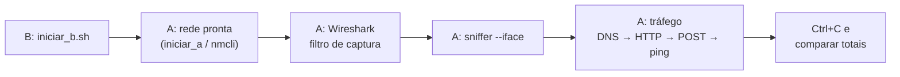

# Guia de comandos

Todos os comandos usados no projeto: o que fazem, o que significa cada parte, o efeito na máquina e na rede, a saída esperada e os erros comuns.

**Legenda de onde cada comando roda:**

| Etiqueta | Máquina | Sistema | Exemplo de placa |
|---|---|---|---|
| **A-Ubuntu** | A (cliente, `192.168.10.1`) | Ubuntu | `enx00e04c8803a2` (USB Realtek) |
| **A-Windows** | A (cliente, `192.168.10.1`) | Windows | `"Ethernet"` |
| **B-Ubuntu** | B (servidor, `192.168.10.2`) | Ubuntu | `enp1s0` / `enp2s0` |

> Nos exemplos, troque o nome da placa pelo nome real da sua máquina (veja com `nmcli device status` ou `Get-NetAdapter`).

---

## Sumário

1. [Instalação](#1-instalação)
2. [Configuração do cabo](#2-configuração-do-cabo)
3. [Servidores (máquina B)](#3-servidores-máquina-b)
4. [Sniffer](#4-sniffer)
5. [Geração de tráfego](#5-geração-de-tráfego)
6. [Wireshark](#6-wireshark)
7. [Diagnóstico](#7-diagnóstico)
8. [Voltar à internet](#8-voltar-à-internet)
9. [Git e testes](#9-git-e-testes)
10. [Sequência da apresentação](#10-sequência-da-apresentação)

---

## 1. Instalação

### 1.1 `sudo apt update` — A-Ubuntu, B-Ubuntu

```bash
sudo apt update
```

| Parte | Significado |
|---|---|
| `sudo` | Executa como administrador (root). Pede a sua senha. |
| `apt` | Gerenciador de pacotes do Ubuntu. |
| `update` | Baixa a lista atualizada de pacotes disponíveis (não instala nada). |

- **Efeito:** atualiza o catálogo local. Precisa de **internet**.
- **Saída:** linhas `Atingido`/`Obter`/`Hit`/`Get` e, no fim, "Lendo listas de pacotes... Pronto".
- **Erros:** "Falha temporária ao resolver" = sem internet. Rode antes de ligar o cabo direto (ou volte à internet, seção 8).

### 1.2 `sudo apt install ...` — A-Ubuntu (e B-Ubuntu, se quiser o Wireshark lá)

```bash
sudo apt install wireshark tcpdump python3-scapy python3-rich
```

| Pacote | Para que serve |
|---|---|
| `wireshark` | Analisador gráfico de pacotes (comparação com o sniffer). Traz a **libpcap**. |
| `tcpdump` | Capturador em linha de comando. Também depende da libpcap. |
| `python3-scapy` | Biblioteca Scapy (versão do Ubuntu, 2.5.x). |
| `python3-rich` | Biblioteca de cores no terminal usada pelo `exibicao.py`. |

- **Efeito:** instala os programas. Durante a instalação do Wireshark aparece a pergunta "Should non-superusers be able to capture packets?" (ver 1.4).
- **Por que `apt` e não `pip`:** no Ubuntu recente, `pip install` fora de um venv dá o erro **"externally-managed-environment"**. Além disso, o sniffer roda com `sudo python3`, que usa o Python do sistema; o `apt` instala justamente ali.
- **Erros:** "libpcap is not available" ao rodar o sniffer = faltou o `tcpdump`/`wireshark`.

A máquina B **não precisa** do Scapy. O `iniciar_b.sh` instala sozinho o que ela precisa (`dnsmasq-base`):

```bash
sudo apt install -y dnsmasq-base     # B-Ubuntu (o iniciar_b.sh faz isso)
```

- `-y` responde "sim" automaticamente.
- `dnsmasq-base` é só o programa, sem o serviço do sistema (o pacote `dnsmasq` completo cria um serviço que fica ocupando a porta 53).

### 1.3 `sudo usermod -aG wireshark $USER` — A-Ubuntu

```bash
sudo usermod -aG wireshark $USER
```

| Parte | Significado |
|---|---|
| `usermod` | Modifica uma conta de usuário. |
| `-a` | *append*: **adiciona** ao grupo sem tirar dos outros. Sem o `-a`, o `-G` substituiria todos os grupos! |
| `-G wireshark` | Grupo suplementar `wireshark`. |
| `$USER` | Variável com o seu nome de usuário. |

- **Efeito:** quem está no grupo `wireshark` pode capturar com o Wireshark **sem rodá-lo como root** (o `dumpcap` tem permissão especial para esse grupo).
- **Importante:** só vale depois de **sair da sessão e entrar de novo** (ou reiniciar). Confira com `groups`.
- **Não afeta o sniffer:** ele roda com `sudo`, então não depende do grupo.

### 1.4 `sudo dpkg-reconfigure wireshark-common` — A-Ubuntu

```bash
sudo dpkg-reconfigure wireshark-common
```

- Reabre a pergunta da instalação: **"Should non-superusers be able to capture packets?"** Responda **Sim/Yes**.
- **Efeito:** cria o grupo `wireshark` e dá ao `dumpcap` as permissões (*capabilities*) de captura para esse grupo.
- **Quando usar:** se respondeu "Não" na instalação e o Wireshark não mostra as interfaces sem root.

### 1.5 Windows — A-Windows

1. **Python** (python.org), marcando **"Add python.exe to PATH"**.
2. **Wireshark** (wireshark.org), aceitando instalar o **Npcap** (sem ele, nem o Wireshark nem o Scapy capturam).
3. Bibliotecas:

```powershell
python -m pip install -r requirements.txt
```

| Parte | Significado |
|---|---|
| `python -m pip` | Roda o `pip` **do mesmo Python** que vai rodar o sniffer (evita instalar em outro Python). |
| `install -r requirements.txt` | Instala tudo que está listado no arquivo: `scapy` e `rich`. |

- Precisa de internet. O `pip` instala o Scapy mais novo (2.6+), por isso existe o `primeiro_item()` no código.
- **Erros:** `'python' não é reconhecido` = Python fora do PATH (reinstale marcando a opção). Abre a Microsoft Store = é o "atalho" do Windows, não o Python real.

Para os testes (qualquer sistema): `python3 -m pip install -r requirements-dev.txt` (inclui o `pytest`). No Ubuntu, prefira `sudo apt install python3-pytest` pelo mesmo motivo do "externally-managed-environment".

---

## 2. Configuração do cabo

### 2.1 Ubuntu (A ou B)

#### `nmcli device status`

```bash
nmcli device status
```

- `nmcli` = linha de comando do **NetworkManager** (o serviço que gerencia a rede no Ubuntu). `device status` lista as placas.
- **Saída:**

  ```
  DEVICE            TYPE      STATE         CONNECTION
  enx00e04c8803a2   ethernet  conectado     cabo-cross
  wlp2s0            wifi      conectado     MinhaRede
  lo                loopback  não gerenciado --
  ```

  `TYPE ethernet` = placa cabeada. `STATE indisponível/unavailable` = sem cabo. `CONNECTION` = perfil ativo.
- Na máquina A-Ubuntu, `enx00e04c8803a2` é o adaptador USB: `en` (Ethernet) + `x` (nome a partir do MAC) + MAC `00:e0:4c:88:03:a2` (`00e04c` = Realtek).

#### `nmcli con add` — criar o perfil do cabo (só uma vez)

Máquina B (o `iniciar_b.sh` faz isso sozinho):

```bash
sudo nmcli con add type ethernet ifname enp1s0 con-name cabo-cross \
    ipv4.method manual ipv4.addresses 192.168.10.2/24 \
    ipv6.method disabled connection.autoconnect no
```

Máquina A-Ubuntu: igual, com `ifname enx00e04c8803a2` e `ipv4.addresses 192.168.10.1/24`.

| Parte | Significado |
|---|---|
| `con add` | Cria um novo **perfil de conexão** (uma configuração salva). |
| `type ethernet` | Perfil para rede cabeada. |
| `ifname enp1s0` | Placa à qual o perfil se aplica. |
| `con-name cabo-cross` | Nome do perfil (escolhido por nós). |
| `ipv4.method manual` | IP **fixo**, sem DHCP (não há servidor DHCP num cabo direto). |
| `ipv4.addresses 192.168.10.2/24` | O IP e a máscara: `/24` = `255.255.255.0`, rede `192.168.10.0`. **Sem gateway** (não foi informado `ipv4.gateway`). |
| `ipv6.method disabled` | Desliga o IPv6 nessa conexão: nada de tráfego IPv6 (o sniffer só trata IPv4). |
| `connection.autoconnect no` | O perfil **não sobe sozinho**; só com `nmcli con up`. Evita que a placa fique com IP fixo quando for ligada ao roteador. |

- **Efeito:** salva o perfil (em `/etc/NetworkManager/system-connections/`). Ainda não ativa.
- **Saída:** `Conexão "cabo-cross" (uuid...) adicionada com sucesso.`
- **Erros:** criar duas vezes gera **dois perfis com o mesmo nome** (confuso). Use `nmcli con show` antes; para mudar algo, use `con mod`.

#### `nmcli con up` / `down`

```bash
sudo nmcli con up cabo-cross      # ativa: aplica o IP 192.168.10.x/24 na placa
sudo nmcli con down cabo-cross    # desativa: remove o IP
```

- **Efeito do `up`:** a placa recebe o IP; a tabela de rotas ganha `192.168.10.0/24 dev <placa>`. Não gera tráfego visível no sniffer (pode haver ARP/anúncios, fora do filtro).
- **Saída:** `Conexão ativada com sucesso`.
- **Erros:** "No suitable device found" / "dispositivo não disponível" = sem cabo (NO-CARRIER) ou placa errada no perfil.

#### `nmcli con mod` — alterar o perfil

```bash
sudo nmcli con mod cabo-cross connection.interface-name enp2s0 \
    ipv4.method manual ipv4.addresses 192.168.10.2/24 \
    ipv6.method disabled connection.autoconnect no
```

- `con mod` muda propriedades de um perfil existente. `connection.interface-name` é o mesmo que o `ifname` do `con add`.
- O `iniciar_b.sh` faz isso quando o perfil já existe (a placa da B pode ser `enp1s0` ou `enp2s0`).
- Para valer na hora, rode `nmcli con up cabo-cross` de novo.

#### `nmcli con show` / `delete`

```bash
nmcli con show                  # lista os perfis (NAME, UUID, TYPE, DEVICE)
nmcli con show cabo-cross       # todos os detalhes de um perfil
sudo nmcli con delete cabo-cross   # apaga o perfil
```

- No `con show`, `DEVICE` preenchido = perfil ativo agora.
- No detalhe, confira `ipv4.addresses`, `ipv6.method`, `connection.autoconnect`.
- `delete` remove a configuração salva (se estiver ativa, a placa perde o IP).

#### `ip a` (`ip addr`) e `ip link`

```bash
ip a                      # todas as placas e seus IPs
ip addr show enp1s0       # só uma placa
ip -4 addr show enp1s0    # só IPv4
ip link                   # estado físico das placas (sem IPs)
sudo ip link set enp1s0 up
```

- **Saída de `ip a`:**

  ```
  2: enp1s0: <BROADCAST,MULTICAST,UP,LOWER_UP> mtu 1500 ... state UP
      link/ether aa:bb:cc:dd:ee:ff brd ff:ff:ff:ff:ff:ff
      inet 192.168.10.2/24 brd 192.168.10.255 scope global noprefixroute enp1s0
  ```

  | Trecho | Significado |
  |---|---|
  | `UP` | Placa ligada (administrativamente). |
  | `LOWER_UP` | **Há sinal no cabo** (link físico). |
  | `NO-CARRIER` | **Sem sinal no cabo**: cabo solto, com defeito ou outra máquina desligada. |
  | `link/ether` | O endereço MAC. |
  | `inet 192.168.10.2/24` | O IPv4 configurado. |

- `ip link set <placa> up` liga a placa (o `iniciar_b.sh` usa antes de esperar o cabo).

#### `ping -c` — testar a conexão (A-Ubuntu ou B-Ubuntu)

```bash
ping -c 4 192.168.10.2     # da A para a B
ping -c 4 192.168.10.1     # da B para a A
```

- `-c 4` = envia 4 pacotes e para (sem `-c`, o Linux pinga para sempre; pare com Ctrl+C).
- **Pacotes gerados:** primeiro um **ARP** (descobrir o MAC do destino), depois 4 **ICMP Echo Request** e 4 **Echo Reply**. Nenhum é TCP/80 nem UDP/53, então **não aparece no sniffer** (bom para provar o filtro).
- **Saída:** `64 bytes from 192.168.10.2: icmp_seq=1 ttl=64 time=0.5 ms` e no fim `4 packets transmitted, 4 received, 0% packet loss`.
- **Erros:** `Destination Host Unreachable` = ARP sem resposta (cabo, IP errado ou outra máquina sem IP). `100% packet loss` sem "unreachable" = firewall bloqueando ICMP do outro lado (comum no Windows com rede Pública).

### 2.2 Windows (A)

#### `Get-NetAdapter` — PowerShell

```powershell
Get-NetAdapter
```

- Lista as placas. **Saída:**

  ```
  Name       InterfaceDescription                 ifIndex Status       LinkSpeed
  Ethernet   Realtek PCIe GbE Family Controller        12 Up           1 Gbps
  Wi-Fi      Intel(R) Wi-Fi 6 AX201                    15 Disconnected 0 bps
  ```

- `Name` é o que vai no `--iface` do sniffer e no `-InterfaceAlias`. `Status Up` = cabo detectado; `Disconnected` = sem sinal.

#### `ipconfig` — cmd ou PowerShell

```powershell
ipconfig
ipconfig /all     # com MAC, DHCP habilitado ou não, etc.
```

- Mostra o IP de cada placa. Esperado na A: `Endereço IPv4: 192.168.10.1`, `Máscara: 255.255.255.0`, `Gateway Padrão:` vazio.
- **`169.254.x.x`** = **APIPA** (*Automatic Private IP Addressing*): o Windows tentou DHCP, ninguém respondeu, e ele se deu um IP aleatório nessa faixa. Significa que **o IP fixo não foi configurado**. Rode o `New-NetIPAddress` (ou o `iniciar_a.bat`).

#### `New-NetIPAddress` — PowerShell **como administrador**

```powershell
New-NetIPAddress -InterfaceAlias "Ethernet" -IPAddress 192.168.10.1 -PrefixLength 24
```

| Parte | Significado |
|---|---|
| `-InterfaceAlias "Ethernet"` | Nome da placa (aspas porque pode ter espaço: `"Ethernet 2"`). |
| `-IPAddress 192.168.10.1` | IP fixo. |
| `-PrefixLength 24` | Máscara `/24` (`255.255.255.0`). Sem `-DefaultGateway`: sem gateway. |

- **Erros:** "Acesso negado" = PowerShell sem administrador. "The object already exists" = esse IP já está lá (tudo certo). Se continuar com `169.254`, o `iniciar_a.ps1` faz a sequência completa: `Set-NetIPInterface -Dhcp Disabled`, `Remove-NetIPAddress` e então `New-NetIPAddress`.

#### `Set-NetConnectionProfile` — PowerShell como administrador

```powershell
Set-NetConnectionProfile -InterfaceAlias "Ethernet" -NetworkCategory Private
```

- O Windows marca redes desconhecidas como **Pública**, com firewall mais restrito (bloqueia ping de entrada e outros). `Private` libera o uso em rede local confiável.
- Confira com `Get-NetConnectionProfile`.
- **Erro:** "No MSFT_NetConnectionProfile objects found" = o perfil ainda não apareceu (espere alguns segundos após configurar o IP).

#### `ping -n` — cmd ou PowerShell

```powershell
ping -n 4 192.168.10.2
```

- No Windows a quantidade é **`-n`** (no Linux é `-c`; `-c` no Windows dá erro).
- **Saída:** `Resposta de 192.168.10.2: bytes=32 tempo<1ms TTL=64`. O `TTL=64` indica que a resposta veio de um Linux (Windows usa 128).
- **Erros:** "Host de destino inacessível" = ARP sem resposta. "Esgotado o tempo limite" = firewall da B (raro no Ubuntu) ou cabo.

---

## 3. Servidores (máquina B)

### 3.1 `./servidor/iniciar_b.sh` — B-Ubuntu (recomendado)

```bash
cd ~/packet-sniffer-redes          # pasta do repositório
./servidor/iniciar_b.sh            # descobre a placa sozinho
./servidor/iniciar_b.sh enp2s0     # ou informa a placa
```

- `./` = "rode o arquivo desta pasta". Precisa ter permissão de execução (se der "Permissão negada": `chmod +x servidor/*.sh` ou `bash servidor/iniciar_b.sh`).
- **O que faz** (detalhado em `docs/explicacao-codigo.md`, seção 5.1): pede o sudo → instala `dnsmasq-base` se faltar → acha a placa ethernet → cria/atualiza o perfil `cabo-cross` → espera o cabo e ativa `192.168.10.2/24` → libera 80/tcp e 53/udp no `ufw` (se ativo) → mata servidores antigos → sobe o HTTP e o DNS → fica mostrando os logs.
- **Saída esperada no fim:**

  ```
  ================================================================
   MÁQUINA B PRONTA
     Placa:  enp1s0    IP: 192.168.10.2
     HTTP:   http://192.168.10.2/   (porta 80/TCP)
     DNS:    servidor.redes -> 192.168.10.2   (porta 53/UDP)
     Os acessos da máquina A aparecem abaixo. Ctrl+C para encerrar.
  ================================================================
  ```

  Depois, cada acesso aparece: `192.168.10.1 - - [data] "GET / HTTP/1.1" 200 -` (log do `http.server`) e `dnsmasq: query[A] servidor.redes from 192.168.10.1` / `dnsmasq: config servidor.redes is 192.168.10.2` (log do dnsmasq).
- **Ctrl+C** encerra os dois servidores e mostra como voltar à internet.
- **Erros:**

  | Mensagem | Causa | O que fazer |
  |---|---|---|
  | `o cabo não foi detectado ... (NO-CARRIER)` | Cabo solto ou A desligada | Encaixar o cabo, conferir as luzes da porta |
  | `nenhuma placa cabeada encontrada` | NetworkManager não vê placa ethernet | Passar o nome: `./servidor/iniciar_b.sh enp2s0` |
  | `não consegui instalar o dnsmasq-base` | Sem internet na 1ª vez | Conectar à internet e rodar de novo |
  | `dnsmasq: failed to create listening socket ... Address already in use` | Outro DNS na porta 53 | `sudo ss -tulpn \| grep :53` e parar o processo |
  | `OSError: [Errno 98] Address already in use` | Outro servidor na porta 80 | `sudo ss -tulpn \| grep :80` |

### 3.2 `python3 -m http.server 80` — B-Ubuntu

```bash
sudo python3 -m http.server 80 --directory servidor/
```

| Parte | Significado |
|---|---|
| `sudo` | Porta 80 é privilegiada no Linux (< 1024 só root). |
| `-m http.server` | Roda o módulo `http.server` da biblioteca padrão do Python como programa. |
| `80` | Porta TCP onde escuta. |
| `--directory servidor/` | Pasta servida (lá está o `index.html`). Sem isso, serve a pasta atual (é o que o `iniciar.sh` faz após `cd`). |

- **Efeito:** abre um socket TCP escutando em `0.0.0.0:80` (todos os IPs). Responde GET/HEAD com os arquivos; `404` para arquivo inexistente; **`501`** para POST, PUT, DELETE etc. (não implementados). Responde em **HTTP/1.0**.
- **Saída:** `Serving HTTP on 0.0.0.0 port 80 (http://0.0.0.0:80/) ...`, e uma linha por requisição.

Equivalentes nos scripts: `./servidor/iniciar.sh` (Ubuntu) e `servidor\iniciar.bat` (Windows, sem `sudo`; pode precisar de administrador/liberar no firewall).

### 3.3 O comando completo do `dnsmasq` — B-Ubuntu

Do `iniciar_b.sh`:

```bash
sudo dnsmasq --no-daemon --no-resolv --no-hosts --bind-interfaces \
    --listen-address=192.168.10.2 \
    --local=/redes/ \
    --host-record=servidor.redes,192.168.10.2 \
    --log-queries
```

| Opção | Significado |
|---|---|
| `--no-daemon` | Fica em primeiro plano, com os logs no terminal (não vira serviço de fundo). |
| `--no-resolv` | Não lê o `/etc/resolv.conf`: não repassa consultas a outro servidor DNS. |
| `--no-hosts` | Não usa o `/etc/hosts`. |
| `--bind-interfaces` | Abre o socket só no endereço indicado (não em todos). Evita conflito com o `systemd-resolved` (`127.0.0.53:53`). |
| `--listen-address=192.168.10.2` | Escuta só no IP do cabo. |
| `--local=/redes/` | O dnsmasq é a autoridade do domínio `.redes`: nome inexistente → **NXDOMAIN**; tipo inexistente (AAAA) → resposta vazia (**NODATA**). |
| `--host-record=servidor.redes,192.168.10.2` | Registro A `servidor.redes → 192.168.10.2` (e o PTR reverso). |
| `--log-queries` | Mostra cada consulta recebida. |
| `\` no fim da linha | Continua o comando na linha de baixo (só para legibilidade). |

- **Efeito:** socket **UDP** (e TCP) na porta 53 de `192.168.10.2`.
- O `iniciar_dns.sh` usa o mesmo comando **sem `--local=/redes/`**: aí um nome inexistente não recebe NXDOMAIN (tende a vir *Refused*, já que não há servidor superior).

### 3.4 `ss -tulpn` — conferir quem está escutando (B-Ubuntu)

```bash
sudo ss -tulpn
sudo ss -tulpn | grep -E ':80|:53'
```

| Opção | Significado |
|---|---|
| `-t` | Sockets TCP. |
| `-u` | Sockets UDP. |
| `-l` | Só os que estão **escutando** (*listening*). |
| `-p` | Mostra o processo dono (precisa de `sudo`). |
| `-n` | Números em vez de nomes (`80` e não `http`). |

- **Saída esperada:**

  ```
  udp  UNCONN 0 0  192.168.10.2:53  0.0.0.0:*  users:(("dnsmasq",pid=...))
  tcp  LISTEN 0 5  192.168.10.2:53  0.0.0.0:*  users:(("dnsmasq",pid=...))
  tcp  LISTEN 0 5       0.0.0.0:80  0.0.0.0:*  users:(("python3",pid=...))
  ```

- Sem linha da porta 80 = HTTP não está rodando. `127.0.0.53:53` é o `systemd-resolved` (normal, não atrapalha graças ao `--bind-interfaces`).

### 3.5 `ufw status` / `ufw allow` — B-Ubuntu

```bash
sudo ufw status
sudo ufw allow 80/tcp
sudo ufw allow 53/udp
```

- `ufw` (*Uncomplicated Firewall*) é a interface simples do firewall do Ubuntu.
- `status`: `Status: inactive` (padrão no Ubuntu desktop, nada bloqueado) ou `active` com a lista de regras.
- `allow 80/tcp`: permite conexões **de entrada** na porta 80 TCP. `allow 53/udp`: idem na 53 UDP.
- O `iniciar_b.sh` só faz o `allow` se o ufw estiver ativo.
- **Sintoma de firewall bloqueando:** ping funciona, mas `curl` dá *timeout* (não "connection refused").

---

## 4. Sniffer

### 4.1 `--listar` — A-Ubuntu / A-Windows

```bash
python3 sniffer/main.py --listar        # Ubuntu
```

```powershell
python sniffer\main.py --listar         # Windows
```

- Mostra as interfaces que o Scapy conhece. **Saída (exemplo Ubuntu):**

  ```
  NOME                 IP               DESCRIÇÃO
  enx00e04c8803a2      192.168.10.1     enx00e04c8803a2
  lo                   127.0.0.1        lo
  wlp2s0               -                wlp2s0
  ```

  No Windows a descrição é o nome do hardware (ex.: `Realtek PCIe GbE Family Controller`). Use a placa cujo IP é `192.168.10.1`.

### 4.2 Captura — A-Ubuntu

```bash
sudo python3 sniffer/main.py --iface enx00e04c8803a2
```

| Parte | Significado |
|---|---|
| `sudo` | Captura exige root (abrir a placa em modo bruto/promíscuo). |
| `python3` | O Python do sistema (onde o `apt` instalou o Scapy). Com venv: `sudo venv/bin/python sniffer/main.py ...`, porque `sudo python3` ignora o venv. |
| `sniffer/main.py` | O programa (rode da raiz do repositório). |
| `--iface enx00e04c8803a2` | Placa do cabo. |

### 4.3 Captura — A-Windows (terminal **como administrador**)

```powershell
python sniffer\main.py --iface "Ethernet"
```

- Aspas porque nomes podem ter espaço (`"Ethernet 2"`).
- Ou, de forma automática: `cliente\iniciar_a.bat` (seção 5.4).

**Saída esperada (os dois sistemas):**

```
Capturando na interface Ethernet (filtro: tcp port 80 or udp port 53). Ctrl+C para parar.

[DNS]  192.168.10.1:42526  -> 192.168.10.2:53     | Consulta DNS: servidor.redes [A]
[DNS]  192.168.10.2:53     -> 192.168.10.1:42526  | Resposta DNS: servidor.redes [A] -> 192.168.10.2
[HTTP] 192.168.10.1:48926  -> 192.168.10.2:80     | GET / (Host: 192.168.10.2)
[HTTP] 192.168.10.2:80     -> 192.168.10.1:48926  | Resposta: HTTP/1.0 200 OK
^C
--- Captura encerrada ---
Total de pacotes capturados: 37
```

Como ler: `[protocolo] IP_origem:porta -> IP_destino:porta | conteúdo decodificado`. IPs = camada 3; portas = camada 4; depois do `|` = camada de aplicação (itens 4 e 5). O total inclui pacotes sem linha (SYN, ACK, FIN).

**Erros comuns:**

| Sintoma | Causa | Solução |
|---|---|---|
| `the following arguments are required` / `one of the arguments --iface --listar is required` | Faltou `--iface` ou `--listar` | Passar um dos dois (não os dois) |
| `PermissionError: [Errno 1] Operation not permitted` (Ubuntu) | Sem `sudo` | `sudo python3 ...` |
| `libpcap is not available` (Ubuntu) | Falta libpcap | `sudo apt install tcpdump` |
| `ModuleNotFoundError: No module named 'scapy'` | Scapy em outro Python (ex.: instalado no venv e rodou `sudo python3`) | `sudo apt install python3-scapy` ou `sudo venv/bin/python` |
| `ValueError: Interface ... not found` / nada aparece | Nome da placa errado | `--listar` e copiar o nome exato |
| Windows: não captura nada | Npcap ausente ou terminal sem administrador | Instalar Npcap (com o Wireshark) e abrir como administrador |
| Comandos rodam mas nada aparece | Tráfego indo por outra placa (ex.: Wi-Fi) | Conferir que o destino é `192.168.10.2` e a placa é a do cabo |

---

## 5. Geração de tráfego

Todos rodam na **máquina A**, com o sniffer já capturando.

### 5.1 `nslookup` — A-Windows / A-Ubuntu

```
nslookup servidor.redes. 192.168.10.2
nslookup naoexiste.redes. 192.168.10.2
```

| Parte | Significado |
|---|---|
| `nslookup` | Ferramenta de consulta DNS. |
| `servidor.redes.` | Nome consultado. **O ponto final** indica nome completo (FQDN, *Fully Qualified Domain Name*): o sistema não acrescenta sufixos. Sem ele, o Windows pode tentar `servidor.redes.iesb.br` (sufixo da rede Wi-Fi). |
| `192.168.10.2` | Servidor DNS a perguntar (a máquina B), ignorando o DNS configurado no sistema. |

- **Pacotes:** UDP da porta efêmera da A para `192.168.10.2:53` e a resposta. O `nslookup` normalmente faz também uma consulta **PTR** (nome do servidor) e pode fazer **AAAA**; elas também aparecem no sniffer.
- **Saída (Windows):**

  ```
  Servidor:  servidor.redes
  Address:  192.168.10.2

  Nome:    servidor.redes
  Address:  192.168.10.2
  ```

  Para `naoexiste.redes.`: `*** servidor.redes não encontrou naoexiste.redes: Non-existent domain` (= NXDOMAIN).
- **Erros:** `timed out` = dnsmasq parado ou ufw bloqueando 53/udp. `Query refused` = dnsmasq sem `--local=/redes/` (usou o `iniciar_dns.sh`) ou nome fora de `.redes`. `Servidor: UnKnown` = a consulta PTR não foi respondida (só estética).

No PowerShell, alternativa usada pelo `iniciar_a.ps1`: `Resolve-DnsName servidor.redes -Server 192.168.10.2 -DnsOnly -Type A`.

### 5.2 `curl` — A-Windows (`curl.exe`) / A-Ubuntu (`curl`)

**Por que `curl.exe` no Windows:** no Windows PowerShell 5.1, `curl` é um **apelido** de `Invoke-WebRequest`, que tem outras opções (`-X`, `-d` não existem) e mostra um objeto do PowerShell. Escrever `curl.exe` chama o curl de verdade (vem com o Windows 10/11). No `cmd`, `curl` já é o curl real, mas o projeto usa `curl.exe` para funcionar nos dois.

```powershell
curl.exe http://192.168.10.2/                               # GET, mostra o HTML
curl.exe http://192.168.10.2/naoexiste                      # GET, resposta 404
curl.exe -X POST -d "teste=123" http://192.168.10.2/        # POST, resposta 501
curl.exe -X PUT -d "x=1" http://192.168.10.2/               # PUT, resposta 501
curl.exe -I http://192.168.10.2/                            # HEAD, só cabeçalhos
curl.exe -v http://192.168.10.2/                            # detalhado
```

| Opção | Significado | No sniffer |
|---|---|---|
| (nenhuma) | GET | `GET / (Host: 192.168.10.2)` e `Resposta: HTTP/1.0 200 OK` |
| `-X POST` | Troca o método da requisição | `POST / (Host: ...)` e `Resposta: HTTP/1.0 501 Unsupported method ('POST')` |
| `-d "teste=123"` | Envia esse texto como corpo da requisição (sozinho já implicaria POST; com `-X PUT` vira PUT com corpo) | O corpo não é mostrado, só a linha da requisição |
| `-I` | Método **HEAD**: pede só os cabeçalhos | `HEAD / (Host: ...)` e `Resposta: HTTP/1.0 200 OK` |
| `-v` | *Verbose*: mostra a conexão (`Trying 192.168.10.2:80... Connected`), as linhas enviadas (`> GET / HTTP/1.1`, `> Host: 192.168.10.2`) e recebidas (`< HTTP/1.0 200 OK`) | Bom para comparar com o que o sniffer decodificou |
| `-s -o NUL -w "%{http_code}"` | (no `gerar_trafego.bat`) silencioso, descarta o corpo, imprime só o código | — |

- **Pacotes:** handshake TCP (3), requisição, ACK, resposta (cabeçalho e corpo), encerramento (FIN/ACK): cerca de 10, todos contados, 2 linhas.
- **Erros:** `Failed to connect ... Connection refused` = HTTP parado na B (a B respondeu RST). `Connection timed out` = firewall ou cabo. `Couldn't resolve host` = digitou nome em vez de IP (o DNS do sistema não conhece `servidor.redes`).

### 5.3 `cliente\gerar_trafego.bat` — A-Windows

```
cliente\gerar_trafego.bat
```

Executa, um por vez (cada um espera uma tecla): `nslookup servidor.redes.`, `nslookup naoexiste.redes.`, GET `/`, GET `/naoexiste`, POST e PUT. Imprime `Resposta: HTTP 200/404/501` para cada `curl`. No fim, lembra de dar Ctrl+C no sniffer.

### 5.4 `cliente\iniciar_a.bat` — A-Windows

```
cliente\iniciar_a.bat
cliente\iniciar_a.bat "Ethernet 2"     # se a placa tiver outro nome
```

- Chama o `iniciar_a.ps1` que: pede administrador (UAC) → confere Python, Npcap, scapy/rich (instala se faltar) → espera o cabo → configura `192.168.10.1/24` e rede Privada → testa ping, HTTP e DNS na B → abre uma janela com o `gerar_trafego.bat` → inicia o sniffer.
- **Saída:** passos `==> ...` em ciano; avisos em amarelo; erros em vermelho.
- **Erros:** `placa 'Ethernet' não encontrada` (mostra a lista; rode com o nome certo); `Npcap não encontrado`; avisos de HTTP/DNS = rode o `iniciar_b.sh` na B antes.

---

## 6. Wireshark

### 6.1 Abrir

```bash
wireshark &        # A-Ubuntu
```

- `&` roda em segundo plano, liberando o terminal.
- No Windows: menu Iniciar → Wireshark (como administrador não é necessário, o Npcap cuida da permissão).
- Se no Ubuntu as placas não aparecem: faltou o grupo `wireshark` (seções 1.3 e 1.4) ou não saiu/entrou na sessão.

### 6.2 Filtro de captura (antes de iniciar)

Na tela inicial, selecione a placa do cabo e, no campo **"...using this filter"** (ou Capture → Options), digite:

```
tcp port 80 or udp port 53
```

- Sintaxe **BPF**, idêntica à `FILTRO_BPF` do sniffer. Assim os dois capturam exatamente os mesmos pacotes e os totais podem ser comparados.
- O que não passa nesse filtro **nunca é gravado** (ARP, ICMP do ping, IPv6...).

### 6.3 Filtros de exibição (depois, na barra verde "Apply a display filter")

| Filtro | O que mostra |
|---|---|
| `http` | Só pacotes que o Wireshark decodificou como HTTP (requisições e respostas; equivalente às linhas `[HTTP]` do sniffer). |
| `dns` | Só mensagens DNS (consultas e respostas). |
| `dns && udp.port == 53` | DNS que trafega por UDP na porta 53 (item 3). `&&` = E. |
| `tcp.port == 80` | **Todos** os segmentos TCP da porta 80: handshake, ACKs, dados, FIN. Mostra os pacotes "a mais" que o sniffer conta mas não exibe. |
| `tcp.port == 80 \|\| udp.port == 53` | Tudo do trabalho. `\|\|` = OU. Com o filtro de captura acima, mostra todos os pacotes. |
| `tcp.flags.syn == 1` | Pacotes com a flag SYN: o SYN e o SYN-ACK de cada conexão (um par por `curl`). |
| `ip.addr == 192.168.10.2` | Pacotes com esse IP como origem **ou** destino. |

Diferença importante: filtro de **exibição** só esconde; os pacotes continuam na captura e na contagem total.

### 6.4 Comparar o total com o sniffer

1. Inicie o Wireshark (com o filtro de captura) e o sniffer **antes** de gerar tráfego.
2. Gere o tráfego.
3. Pare o Wireshark (quadrado vermelho) e o sniffer (Ctrl+C).
4. Na barra de status do Wireshark, **sem filtro de exibição**, veja `Packets: N · Displayed: N`. Compare com `Total de pacotes capturados: N` do sniffer.

Por que o **ARP** aparece no Wireshark às vezes e nunca no sniffer: o ARP não é IP nem tem porta, então não passa no BPF `tcp port 80 or udp port 53`. Ele só aparece se o Wireshark estiver capturando **sem filtro de captura**. Se for o caso, a contagem não bate; use o filtro de captura igual ao do sniffer.

Pequenas diferenças também podem vir de iniciar/parar os dois em momentos diferentes (um pacote que chegou só para um deles).

Para ver camadas 3 e 4 de um pacote: clique nele e expanda **Internet Protocol Version 4** (Source, Destination) e **Transmission Control Protocol** / **User Datagram Protocol** (Source Port, Destination Port).

---

## 7. Diagnóstico

### 7.1 `tcpdump` — A-Ubuntu ou B-Ubuntu

```bash
sudo tcpdump -i enp1s0 -n 'tcp port 80 or udp port 53'
sudo tcpdump -i enp1s0 -n arp or icmp
sudo tcpdump -i enp1s0 -n -c 20
```

| Opção | Significado |
|---|---|
| `-i enp1s0` | Interface. |
| `-n` | Não traduz IPs/portas em nomes (mais rápido e claro). |
| `'tcp port 80 or udp port 53'` | O mesmo filtro BPF do sniffer (aspas para o shell não interpretar). |
| `-c 20` | Para após 20 pacotes. |

- **Saída:** `IP 192.168.10.1.48926 > 192.168.10.2.80: Flags [S], seq ...` (`[S]` = SYN, `[S.]` = SYN-ACK, `[.]` = ACK, `[P.]` = dados, `[F.]` = FIN). Para DNS: `IP 192.168.10.1.42526 > 192.168.10.2.53: 1+ A? servidor.redes. (32)`.
- **Uso:** rodando na **B**, prova que os pacotes estão chegando lá (separa problema de rede de problema do sniffer). No fim mostra `N packets captured / N packets dropped by kernel`.

### 7.2 Checklist rápido

| Pergunta | Comando | Esperado |
|---|---|---|
| Cabo tem sinal? | `ip link` / `Get-NetAdapter` | `LOWER_UP` / `Up` |
| IP certo? | `ip a` / `ipconfig` | `192.168.10.x/24` (não `169.254`) |
| Máquinas se enxergam? | `ping -c 4` / `ping -n 4` | Respostas |
| Servidores escutando? | `sudo ss -tulpn` (B) | `:80` python3, `192.168.10.2:53` dnsmasq |
| Firewall? | `sudo ufw status` (B) | inactive, ou 80/tcp e 53/udp ALLOW |
| HTTP responde? | `curl.exe -v http://192.168.10.2/` | `HTTP/1.0 200 OK` |
| DNS responde? | `nslookup servidor.redes. 192.168.10.2` | `192.168.10.2` |
| Pacotes chegam na B? | `sudo tcpdump -i <placa> -n ...` (B) | Linhas aparecem |

---

## 8. Voltar à internet

### Ubuntu (A ou B)

```bash
sudo nmcli con down cabo-cross                   # tira o IP fixo do cabo
nmcli con show                                   # veja o nome da conexão de internet
sudo nmcli con up "Conexão cabeada 1"            # ou o nome que aparecer (ou reconecte o Wi-Fi)
```

- Como o `cabo-cross` tem `autoconnect no`, ao ligar o cabo no roteador o NetworkManager ativa o perfil normal (DHCP) sozinho ou com o `con up` acima. O `iniciar_b.sh` mostra essa dica ao encerrar.
- Se quiser apagar de vez: `sudo nmcli con delete cabo-cross`.

### Windows (A), PowerShell como administrador

```powershell
Remove-NetIPAddress -InterfaceAlias "Ethernet" -IPAddress 192.168.10.1 -Confirm:$false
Set-NetIPInterface -InterfaceAlias "Ethernet" -Dhcp Enabled
```

- Remove o IP fixo e religa o DHCP (o `iniciar_a.ps1` desliga o DHCP). Esses comandos não estão nos scripts do projeto; são o caminho inverso do que o `iniciar_a.ps1` faz. Alternativa gráfica: Configurações → Rede → Ethernet → Atribuição de IP → Automático (DHCP).

---

## 9. Git e testes

```bash
git pull                     # baixa e aplica as mudanças do GitHub no branch atual
git checkout main            # muda para o branch main
git status                   # mostra o branch atual e arquivos modificados
python3 -m pytest -q         # roda os testes
```

| Comando | Efeito | Saída esperada / erros |
|---|---|---|
| `git pull` | `fetch` + `merge` do branch remoto. Precisa de internet. | `Already up to date.` ou a lista de arquivos alterados. Conflito = há mudanças locais nos mesmos arquivos; `git status` para ver. |
| `git checkout main` | Troca os arquivos da pasta para os do branch `main`. | `Switched to branch 'main'`. Erro "would be overwritten" = mudanças locais não salvas. |
| `git status` | Só consulta, não muda nada. | `On branch main ... nothing to commit, working tree clean`. |
| `python3 -m pytest -q` | Roda os 15 testes de `tests/` (`-q` = saída resumida). Não precisa de root nem de rede. | `15 passed`. `No module named pytest` = instalar (`sudo apt install python3-pytest` ou `pip install -r requirements-dev.txt`). |

No Windows: `python -m pytest -q`.

---

## 10. Sequência da apresentação



| # | Máquina | Comando | O que mostrar ao professor | Item |
|---|---|---|---|---|
| 0 | B-Ubuntu | `./servidor/iniciar_b.sh` | Mensagem "MÁQUINA B PRONTA": IP `192.168.10.2`, HTTP na 80/TCP, DNS na 53/UDP | ambiente |
| 1 | A | Ubuntu: `sudo nmcli con up cabo-cross` · Windows: `cliente\iniciar_a.bat` (ou `New-NetIPAddress` + `Set-NetConnectionProfile`) | `ip a`/`ipconfig` com `192.168.10.1/24`, sem gateway | ambiente |
| 2 | A | `ping -c 4 192.168.10.2` / `ping -n 4 192.168.10.2` | As máquinas se enxergam (ainda sem sniffer) | ambiente |
| 3 | A | Ubuntu: `python3 sniffer/main.py --listar` · Windows: `python sniffer\main.py --listar` | Qual placa é a do cabo (IP `192.168.10.1`) | 1 |
| 4 | A | `wireshark &` → placa do cabo → filtro de captura `tcp port 80 or udp port 53` → iniciar | Mesmo filtro BPF do sniffer | 1 |
| 5 | A | Ubuntu: `sudo python3 sniffer/main.py --iface enx00e04c8803a2` · Windows (admin): `python sniffer\main.py --iface "Ethernet"` | "Capturando na interface ... (filtro: ...)". Explicar `iface`, BPF no kernel, `store=False` | 1 |
| 6 | A (outro terminal) | `nslookup servidor.redes. 192.168.10.2` | `[DNS]` consulta e resposta aparecem **na hora**; `-> 192.168.10.2`. No Wireshark: `dns && udp.port == 53` | 1, 3, 5 |
| 7 | A | `nslookup naoexiste.redes. 192.168.10.2` | `(NXDOMAIN)`: o sniffer decodifica o `rcode` | 3, 5 |
| 8 | A | `curl.exe http://192.168.10.2/` (Ubuntu: `curl`) | `GET / (Host: 192.168.10.2)` e `Resposta: HTTP/1.0 200 OK`. Wireshark: `http`, depois `tcp.port == 80` (mostra handshake/ACK/FIN) e `tcp.flags.syn == 1` | 2, 5 |
| 9 | — | Apontar uma linha | `192.168.10.1:48926 -> 192.168.10.2:80`: IPs (camada 3), portas (camada 4, efêmera ↔ 80); na resposta, invertido. Conferir no Wireshark (IPv4 Src/Dst, TCP Src/Dst Port) | 4 |
| 10 | A | `curl.exe -X POST -d "teste=123" http://192.168.10.2/` | `POST / (Host: ...)` decodificado; o 501 é do `http.server` (só GET/HEAD) | 5 |
| 11 | A | `ping -n 4 192.168.10.2` | **Nada** aparece no sniffer: ICMP não é TCP/80 nem UDP/53 | 2, 3 |
| 12 | A | Ctrl+C no sniffer; parar o Wireshark | `Total de pacotes capturados: N` = `Packets: N` do Wireshark → nenhum quadro perdido | 1 |
| 13 | B | Ctrl+C no `iniciar_b.sh` | Servidores encerrados | — |

> Atalho no Windows: no passo 1, o `cliente\iniciar_a.bat` já faz os passos 1, 2 e 5 e abre o `cliente\gerar_trafego.bat`, que executa os passos 6, 7, 8 e 10 (mais GET 404 e PUT) um de cada vez.
>
> Cuidado com a contagem: o `iniciar_a.ps1` testa HTTP e DNS na máquina B **antes** de o sniffer iniciar. Se o Wireshark já estiver capturando nesse momento, ele terá alguns pacotes a mais. Para os totais baterem, (re)inicie a captura do Wireshark quando aparecer "Iniciando o sniffer" e **antes** de apertar a primeira tecla no `gerar_trafego.bat`.
